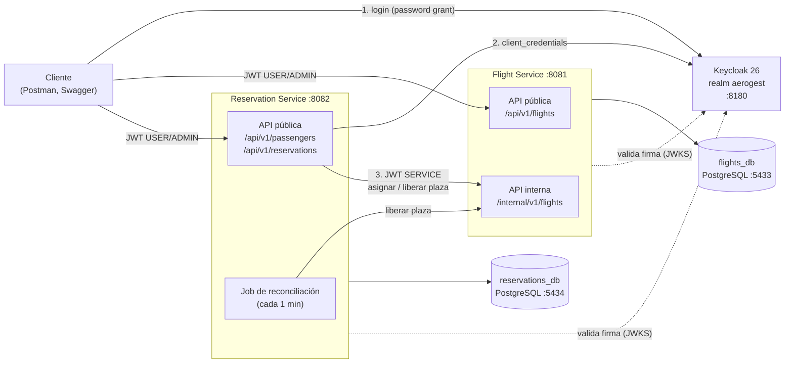
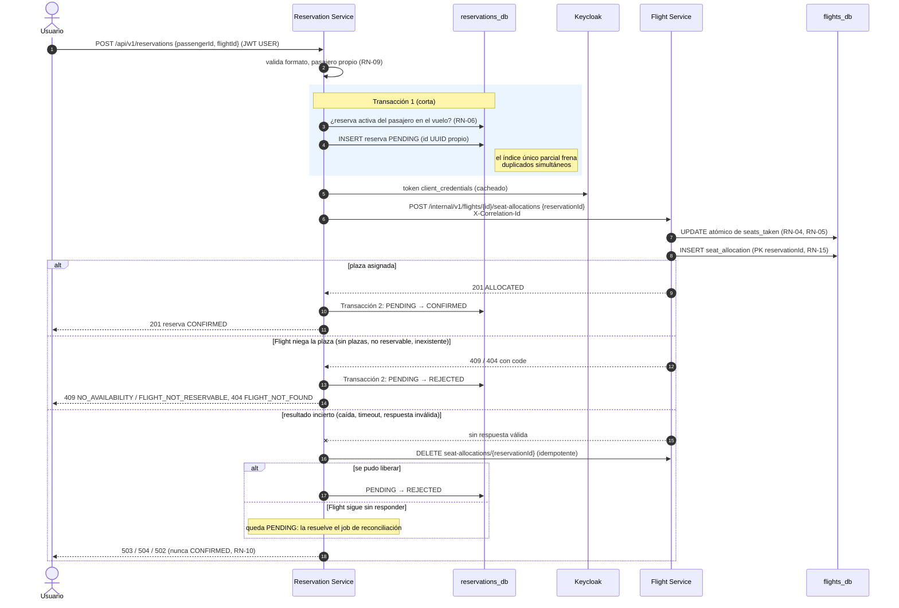
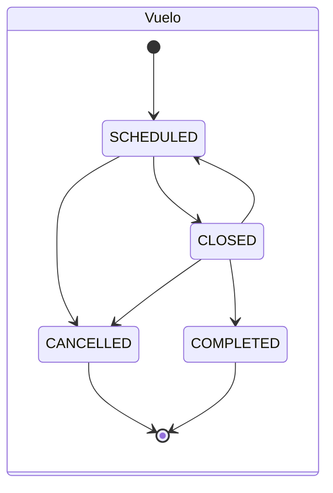
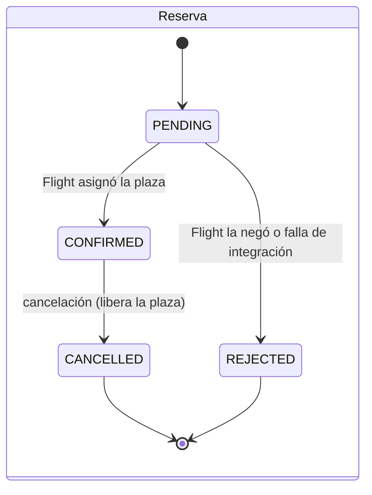
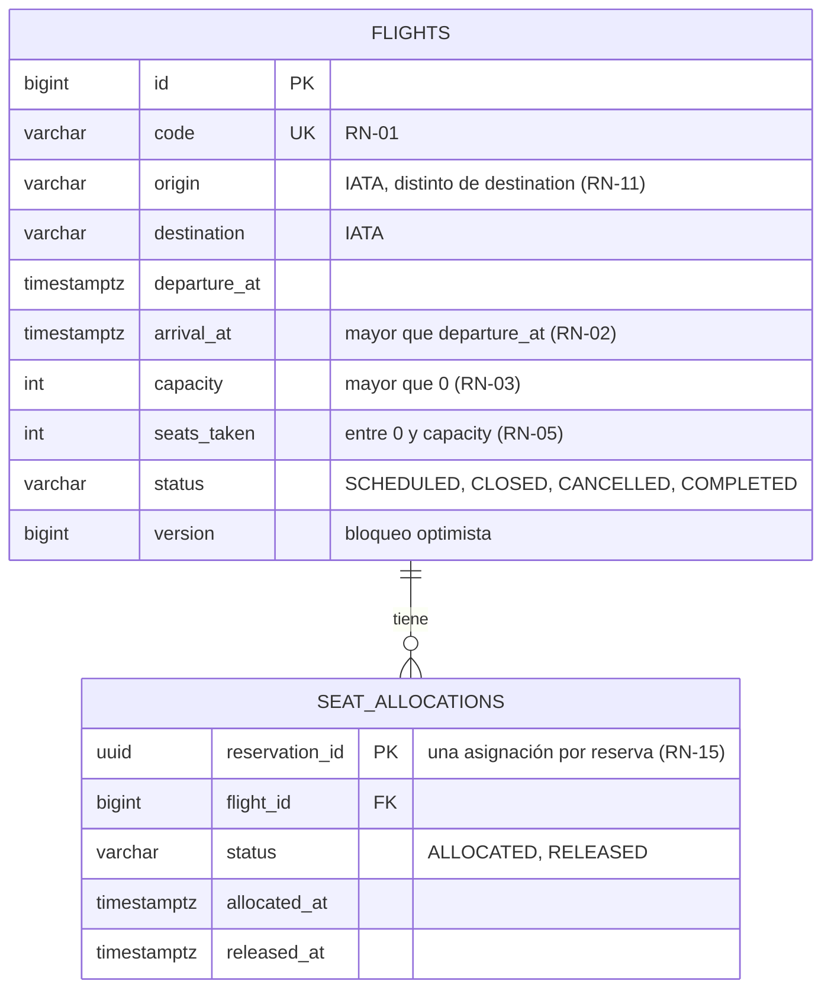
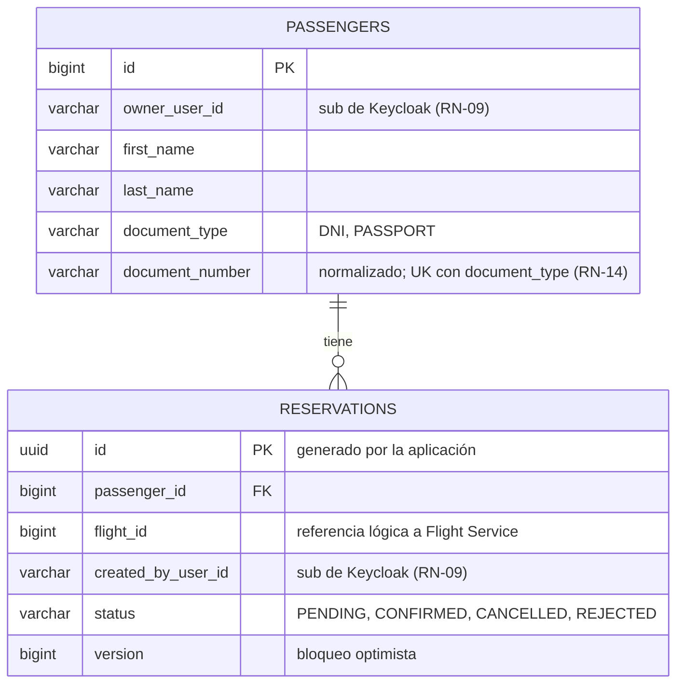

# AeroGest: arquitectura y diseño

Este documento describe el dominio, el alcance del MVP, la arquitectura, los procesos principales,
el modelo de datos, los contratos de las APIs y las reglas de negocio. Las decisiones y sus
alternativas están en [`docs/adr/`](adr/).

## 1. Dominio y alcance del MVP

AeroGest es el backend de una aerolínea para administrar vuelos comerciales y reservas de pasajeros.
El problema central es **no confirmar reservas inválidas**: sin plazas, en vuelos que no las admiten,
duplicadas o sin haber podido validar el vuelo. Esto se complica porque las plazas y las reservas
viven en dos servicios distintos, con bases de datos separadas, bajo concurrencia y con fallos de red.

**Dentro del alcance:** gestión de vuelos y sus estados, disponibilidad de plazas, gestión básica de
pasajeros, creación, consulta y cancelación de reservas, integración entre servicios, seguridad,
persistencia, pruebas y documentación de las APIs.

**Fuera del alcance:** pagos, reembolsos, facturación, check-in, embarque, equipaje, tripulación,
control de tráfico aéreo y asientos individuales (solo se gestiona la cantidad de plazas, ADR 0001).

## 2. Actores y permisos

| Actor | Rol en Keycloak | Puede |
|---|---|---|
| Administrador | `ADMIN` | Crear, modificar y cambiar el estado de vuelos. Ver y cancelar pasajeros y reservas de cualquier usuario |
| Usuario | `USER` | Consultar vuelos. Registrar sus pasajeros y reservar, consultar y cancelar **sus** reservas |
| Reservation Service | `SERVICE` | Usar solo la API interna de Flight Service (`/internal/**`). No tiene acceso a la API pública |
| Sin autenticar | — | Solo la documentación (Swagger) y `/actuator/health` |

El rol habilita el endpoint; qué datos puede tocar cada usuario lo deciden los servicios según el
claim `sub` del token. Un recurso ajeno responde **403** (RN-09).

## 3. Arquitectura



- **Dos microservicios con responsabilidades separadas**, cada uno dueño de su base. Reservation
  nunca lee las tablas de Flight: le pregunta por HTTP.
- **Flight Service** es la fuente de verdad de las plazas. Ocupar una plaza es una sentencia atómica
  `UPDATE flights SET seats_taken = seats_taken + 1 WHERE id = ? AND status = 'SCHEDULED' AND
  departure_at > now AND seats_taken < capacity`. Si no afecta filas, no hay plaza: no hace falta
  bloquear ni consultar antes.
- **Reservation Service** orquesta el proceso de reserva y guarda pasajeros y reservas. La referencia
  al vuelo (`flight_id`) es lógica, sin clave foránea entre bases.
- **Keycloak** es infraestructura de identidad (ADR 0002), no un microservicio de negocio.
  Los servicios solo validan la firma de los tokens y no comparten secretos entre sí.

Capas de cada servicio: `controller` (HTTP y validación de formato) → `service` (casos de uso y
transacciones) → `domain` (entidades con sus reglas y transiciones) → `repository` (Spring Data JPA).
Los contratos son DTOs (`record`); las entidades JPA no se exponen.

## 4. Proceso de reserva



Por qué así (detalle en [ADR 0003](adr/0003-flujo-de-reserva-y-consistencia.md)):
- La llamada HTTP queda **fuera de las transacciones**: mientras se espera a Flight no se retiene
  una conexión ni bloqueos de la base.
- El id de la reserva se genera **antes** de llamar a Flight y viaja como **clave de idempotencia**:
  un reintento o una liberación posterior se refieren siempre a la misma asignación.
- Liberar una reserva que nunca ocupó plaza deja una ficha `RELEASED`; si la asignación original
  llega tarde, Flight la rechaza. Así la compensación es segura aunque no se sepa qué pasó.

**Cancelación (RN-07):** se verifica que la reserva esté `CONFIRMED`, se libera la plaza en Flight
(idempotente) y recién entonces se marca `CANCELLED`. Si Flight no responde, la reserva sigue
`CONFIRMED` y se puede reintentar. Dos cancelaciones simultáneas: Flight devuelve la plaza una sola
vez y `@Version` hace que solo una de las dos marque la reserva.

**Reconciliación:** cada minuto un job toma las reservas `PENDING` de más de 5 minutos, libera su
plaza y las marca `REJECTED`. Si Flight sigue caído, lo intenta en la próxima ejecución.

## 5. Estados y transiciones (RN-08)



Un vuelo admite reservas solo en `SCHEDULED` y antes de su salida (RN-04). `CANCELLED` y
`COMPLETED` son terminales: el vuelo ya no se puede modificar.



Solo `PENDING` y `CONFIRMED` son **activas**: cuentan para RN-06 y pueden ocupar una plaza.

## 6. Modelo de datos

Cada servicio tiene su propia base y su esquema se crea solo con migraciones Flyway
(`ddl-auto: validate`).





Restricciones que garantizan las reglas aunque haya solicitudes simultáneas:

| Restricción | Base | Garantiza |
|---|---|---|
| `uq_flights_code` | flights | RN-01 |
| `ck_flights_times`, `ck_flights_capacity`, `ck_flights_route` | flights | RN-02, RN-03, RN-11 |
| `ck_flights_seats` (`0 <= seats_taken <= capacity`) | flights | RN-05, última barrera ante cualquier error |
| PK `seat_allocations.reservation_id` | flights | RN-15: una asignación por reserva |
| `uq_passengers_document` | reservations | RN-14 |
| índice único parcial `uq_reservations_active_passenger_flight` (`WHERE status IN ('PENDING','CONFIRMED')`) | reservations | RN-06 |

Todas las tablas tienen además `created_at` y `updated_at`.

## 7. Contratos de las APIs

La documentación interactiva está en `http://localhost:8081/swagger-ui.html` y
`http://localhost:8082/swagger-ui.html` (botón *Authorize* con un token Bearer).

### Flight Service (8081)

| Método y ruta | Rol | Respuestas |
|---|---|---|
| `POST /api/v1/flights` | ADMIN | 201, 400 (`VALIDATION_ERROR`, `INVALID_SCHEDULE`, `INVALID_ROUTE`, `DEPARTURE_IN_PAST`, `INVALID_CAPACITY`), 409 `DUPLICATE_FLIGHT_CODE` |
| `GET /api/v1/flights?origin&destination&status&departureFrom&departureTo&page&size` | USER, ADMIN | 200 (página) |
| `GET /api/v1/flights/{id}` | USER, ADMIN | 200, 404 `FLIGHT_NOT_FOUND` |
| `PUT /api/v1/flights/{id}` | ADMIN | 200, 400, 404, 409 `FLIGHT_NOT_MODIFIABLE` |
| `PATCH /api/v1/flights/{id}/status` | ADMIN | 200, 409 `INVALID_STATUS_TRANSITION` |
| `GET /internal/v1/flights/{id}/availability` | SERVICE | 200 `{flightId, status, capacity, availableSeats, acceptsReservations}` |
| `POST /internal/v1/flights/{id}/seat-allocations` `{reservationId}` | SERVICE | 201 nueva, 200 reintento ya procesado, 404, 409 `NO_AVAILABILITY`, `FLIGHT_NOT_RESERVABLE`, `ALLOCATION_CONFLICT` |
| `DELETE /internal/v1/flights/{id}/seat-allocations/{reservationId}` | SERVICE | 204 (idempotente), 404 |

### Reservation Service (8082)

| Método y ruta | Rol | Respuestas |
|---|---|---|
| `POST /api/v1/passengers` | USER, ADMIN | 201, 400 (`VALIDATION_ERROR`, `INVALID_PASSENGER_DATA`), 409 `DUPLICATE_PASSENGER_DOCUMENT` |
| `GET /api/v1/passengers` · `GET /api/v1/passengers/{id}` | USER, ADMIN | 200, 403, 404 `PASSENGER_NOT_FOUND` |
| `PUT /api/v1/passengers/{id}` `{firstName, lastName}` | USER, ADMIN | 200, 400, 403, 404 |
| `POST /api/v1/reservations` `{passengerId, flightId}` | USER, ADMIN | 201 `CONFIRMED`; 403; 404 `PASSENGER_NOT_FOUND`, `FLIGHT_NOT_FOUND`; 409 `DUPLICATE_ACTIVE_RESERVATION`, `NO_AVAILABILITY`, `FLIGHT_NOT_RESERVABLE`; 502 `INVALID_FLIGHT_RESPONSE`; 503 `FLIGHT_SERVICE_UNAVAILABLE`; 504 `FLIGHT_SERVICE_TIMEOUT` |
| `GET /api/v1/reservations` · `GET /api/v1/reservations/{id}` | USER, ADMIN | 200, 403, 404 `RESERVATION_NOT_FOUND` |
| `POST /api/v1/reservations/{id}/cancel` | USER, ADMIN | 200 `CANCELLED`, 403, 404, 409 `INVALID_RESERVATION_STATE`, `CONCURRENT_MODIFICATION`, 503 |

### Formato de errores

Los dos servicios responden con RFC 7807 más un `code` estable, que es lo que interpretan los
clientes (incluido Reservation Service al leer los errores de Flight):

```json
{
  "type": "about:blank",
  "title": "Conflict",
  "status": 409,
  "detail": "El vuelo no tiene plazas disponibles",
  "code": "NO_AVAILABILITY",
  "correlationId": "9237a49b-b8d6-42d0-8cd9-6cab8b149a72"
}
```

Sin token: 401 `UNAUTHENTICATED`. Rol insuficiente o recurso ajeno: 403 `ACCESS_DENIED`.

### Integración y trazabilidad

- **Timeouts:** conexión 2 s y lectura 3 s (`FLIGHT_SERVICE_CONNECT_TIMEOUT_MS`, `FLIGHT_SERVICE_READ_TIMEOUT_MS`).
- **Token de servicio:** se pide con `client_credentials`, se cachea y se renueva 30 s antes de
  vencer. Ante un 401 de Flight se pide uno nuevo y se reintenta una sola vez.
- **Clasificación de respuestas de Flight:** 404 y 409 con `code` conocido son rechazos definitivos.
  Caída, timeout, 5xx, 401/403 y cuerpos inválidos son resultados inciertos, y nunca se confirma.
- **Correlation id:** cada solicitud recibe un `X-Correlation-Id` (o se genera uno). Va al log de
  los dos servicios, se reenvía a Flight y aparece en las respuestas de error.

## 8. Reglas de negocio

| Regla | Descripción | Dónde se garantiza |
|---|---|---|
| RN-01 | Código de vuelo único | `FlightService` y restricción `uq_flights_code` |
| RN-02 | La llegada es posterior a la salida | `Flight` y `ck_flights_times` |
| RN-03 | Datos obligatorios del vuelo y capacidad mayor que 0 | DTO con Bean Validation, `Flight` y `ck_flights_capacity` |
| RN-04 | No se reserva en vuelos que no estén `SCHEDULED` o que ya salieron | `UPDATE` atómico de Flight (`Flight.isReservable`) |
| RN-05 | Nunca más reservas confirmadas que plazas | `UPDATE ... WHERE seats_taken < capacity` y `ck_flights_seats` |
| RN-06 | Un pasajero no tiene dos reservas activas en el mismo vuelo | Verificación previa e índice único parcial |
| RN-07 | Cancelar libera la plaza una sola vez; no se cancela dos veces | `Reservation.cancel`, liberación idempotente en Flight y `@Version` |
| RN-08 | Transiciones de estado válidas | `FlightStatus` y `ReservationStatus` |
| RN-09 | Solo usuarios autorizados; nadie accede a datos ajenos salvo ADMIN | `SecurityConfig` (roles) y `CurrentUser.canAccess` (`sub`) |
| RN-10 | Sin validar en Flight no se confirma | `ReservationService` y `FlightServiceException` |
| RN-11 | Origen distinto de destino | `Flight` y `ck_flights_route` |
| RN-12 | No se crea un vuelo con salida en el pasado | `Flight.create` |
| RN-13 | No se reduce la capacidad por debajo de las plazas ocupadas | `Flight.update` |
| RN-14 | El documento (tipo y número normalizado) es único | `DocumentType.normalize` y `uq_passengers_document` |
| RN-15 | Asignar y liberar son idempotentes por `reservationId` | PK de `seat_allocations` y `SeatInventoryService` |

La relación de cada regla con sus pruebas está en la [matriz de trazabilidad](trazabilidad.md).
