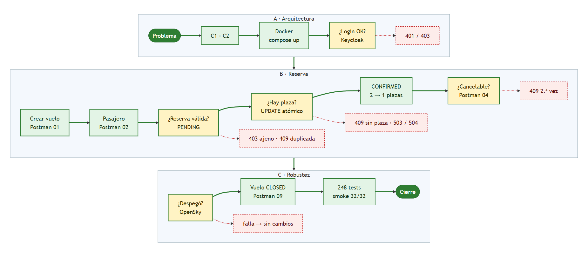
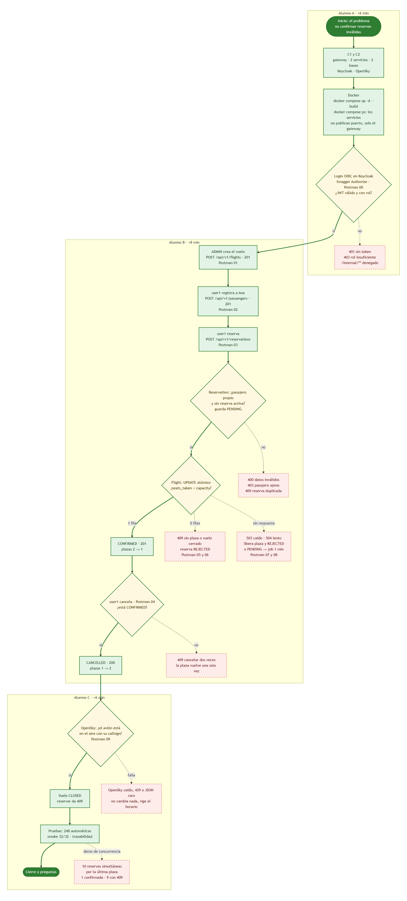
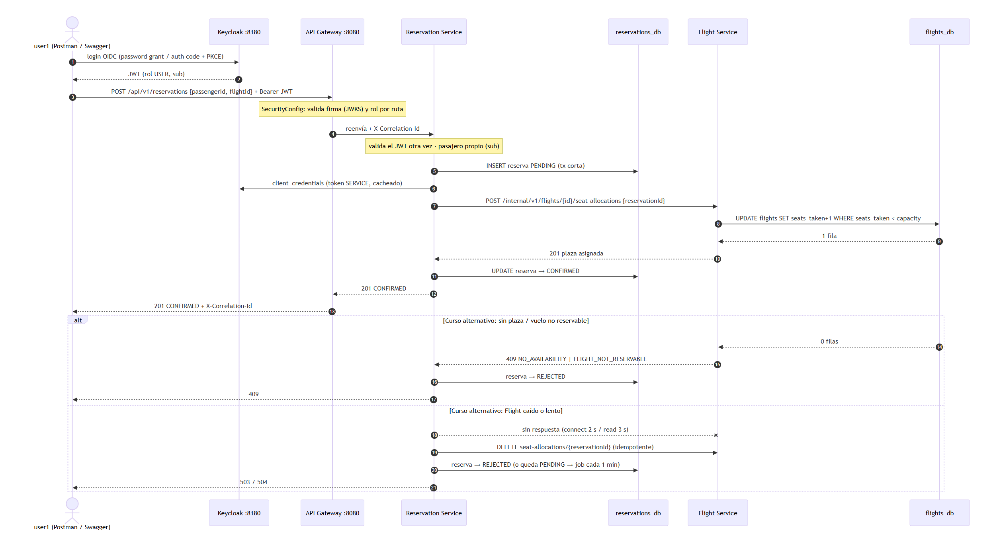

# Presentación de AeroGest — flujo y speech para 3 integrantes

Este es el guion principal de la presentación oral. Reemplaza el reparto en 4 bloques de
[guion-presentacion.md](guion-presentacion.md). Los comandos de bajo nivel y las respuestas largas a
preguntas siguen en [guion-defensa.md](guion-defensa.md).

**Idea rectora:** la presentación sigue el **curso normal** de una reserva de punta a punta. Los
cursos alternativos se nombran en una frase al pasar por cada decisión ("si no, pasa tal cosa") y
solo se demuestran si sobra tiempo o si los piden.

| Integrante | Bloque | Tiempo | Herramientas en pantalla |
|---|---|---|---|
| **Alumno A** | Problema, arquitectura, Docker, seguridad y Keycloak | ≈ 6 min | Diagramas C4, terminal (Docker), Swagger (login) |
| **Alumno B** | Curso normal de la reserva: vuelo → pasajero → reserva → cancelación | ≈ 8 min | Postman 00–04, Swagger, código de los servicios |
| **Alumno C** | Robustez (alternativos), OpenSky, pruebas y cierre | ≈ 6 min | Postman 05–09, terminal (smoke), evidencias |

Reemplazá **Alumno A/B/C** por los nombres. La rúbrica (PRE-01) puede pedir que cualquiera responda
sobre cualquier parte: cada uno lee también los otros dos bloques.

---

## 1. Diagramas de guía

### Para la diapositiva: versión compacta



Una franja por alumno. Verde = curso normal, amarillo = punto de decisión, rojo punteado = curso
alternativo. Fuente: [diagramas/12-flujo-presentacion-compacto.mmd](diagramas/12-flujo-presentacion-compacto.mmd).

### Flujo de la presentación, versión detallada (para estudiar, no para proyectar)



- **Columna verde, flechas gruesas:** curso normal. Es lo que se cuenta y se demuestra siempre.
- **Rombos:** puntos de decisión. Ahí se menciona en una frase el curso alternativo.
- **Cajas rojas punteadas:** cursos alternativos, con la carpeta de Postman que los prueba.
- Fuente editable: [diagramas/10-flujo-presentacion.mmd](diagramas/10-flujo-presentacion.mmd).

### Secuencia de la reserva (el corazón técnico)



Pasos 1–13 = curso normal. El bloque `alt` del final = los dos cursos alternativos importantes.
Fuente: [diagramas/11-secuencia-reserva.mmd](diagramas/11-secuencia-reserva.mmd).

---

## 2. Preparación (15 min antes, la hace Alumno A)

```powershell
cd aerogest
docker compose up -d                       # Keycloak tarda hasta 3 min
curl.exe http://localhost:8180/realms/aerogest
curl.exe http://localhost:8080/actuator/health
. .\scripts\load-env.ps1
.\scripts\smoke-reservations.ps1           # calienta el sistema: debe dar 32 correctas, 0 fallidas
```

Dejar abiertos, en este orden de pestañas:
1. Las diapositivas (con los dos diagramas de arriba y los C4 de `docs/diagramas/`).
2. Terminal con `docker compose ps` y otra con
   `docker compose logs -f api-gateway reservation-service flight-service`.
3. Swagger: `http://localhost:8080/swagger-ui.html`.
4. Postman con `postman/AeroGest.postman_collection.json` y el entorno
   `postman/aerogest-local.postman_environment.json` (las 3 claves del `.env` cargadas).
5. El IDE con los archivos de la tabla del §6 ya abiertos.

> No correr tests de Maven mientras se presenta: con la máquina cargada la primera petición puede
> pasar los 15 s del gateway y dar 504.

---

## 3. Alumno A — Problema, arquitectura y despliegue (≈ 6 min)

### A1 · Apertura (30 s) — *diapositiva de portada*
> Buenas, somos [A], [B] y [C]. Les presentamos **AeroGest**, el backend de una aerolínea para
> administrar vuelos y reservas. Vamos a seguir una reserva de punta a punta: yo les muestro la
> arquitectura y cómo se levanta, [B] recorre el proceso de reserva con el código, y [C] muestra qué
> pasa cuando las cosas salen mal, la integración con OpenSky y cómo lo probamos.

### A2 · El problema (1 min) — *diagrama de flujo, nodo "Inicio"*
> Reservar parece un INSERT, pero en nuestro sistema las **plazas** viven en un servicio y las
> **reservas** en otro, cada uno con su base. El objetivo es **no confirmar nunca una reserva
> inválida**: ni dos personas en la última plaza, ni el mismo pasajero dos veces, ni una reserva
> confirmada si el servicio de vuelos no contestó. Este diagrama es el mapa de la presentación: la
> columna verde es el camino normal, y lo rojo, lo que puede fallar.

### A3 · Arquitectura C1 y C2 (1 min 30 s) — *`C4_Contexto_AeroGest.png` y `C4_Contenedores_AeroGest.png`*
> En el contexto, AeroGest lo usan administradores y usuarios, y depende de dos sistemas externos:
> Keycloak, que maneja la identidad, y OpenSky, una API pública de tráfico aéreo.
> Por dentro: un **API Gateway** como única puerta de entrada y dos microservicios en Spring Boot 4
> con Java 21. **Flight Service** es dueño de los vuelos y del **contador de plazas**;
> **Reservation Service** es dueño de pasajeros y reservas y **orquesta** el proceso. Cada uno tiene
> su PostgreSQL y ninguno lee la base del otro: se hablan por HTTP.

**Dónde está:** rutas del gateway en
[api-gateway/src/main/resources/application.yml:24-44](../api-gateway/src/main/resources/application.yml)
(`/api/v1/flights/**` → Flight, `/api/v1/passengers/**` y `/api/v1/reservations/**` → Reservation).

### A4 · Docker (1 min) — *terminal*
Mostrar `docker compose ps`.
> Todo levanta con un `docker compose up -d --build`. Son seis contenedores: dos PostgreSQL,
> Keycloak, los dos servicios y el gateway. Fíjense en la columna de puertos: **los microservicios
> no publican ninguno**. Desde afuera solo se entra por el gateway, en el 8080. Las imágenes son
> multi-etapa: primero instalan nuestro JAR común en Maven y después compilan el servicio.

**Dónde está:** [docker-compose.yml](../docker-compose.yml) — servicios en las líneas 10 (`flights-db`),
27 (`reservations-db`), 44 (`keycloak`), 66 (`flight-service`), 83 (`reservation-service`) y
102 (`api-gateway`, el único servicio Java con `ports`). Los secretos van en `.env` (plantilla
`.env.example`). El realm de Keycloak se importa solo desde `keycloak/aerogest-realm.json`.

### A5 · Seguridad y Keycloak (1 min 30 s) — *Swagger: Authorize → keycloak*
Hacer el login en vivo con `user1`.
> Para la seguridad usamos **Keycloak** con OpenID Connect. Desde Swagger hacemos el login real:
> *authorization code* con PKCE, y volvemos con un **JWT** que trae el rol.
> Hay tres roles: ADMIN, USER y SERVICE, que es el rol del propio Reservation cuando le habla a Flight.
> El **Security Filter del gateway** es la primera barrera: sin token responde 401, con un rol que no
> corresponde responde 403, y la API interna `/internal/**` no se publica para nadie.
> Los servicios **vuelven a validar el token**, porque el gateway no sabe de quién es cada reserva:
> eso se decide con el `sub` del token, adentro del servicio.

**Dónde está:**
- Security Filter: [api-gateway/.../config/SecurityConfig.java:33-47](../api-gateway/src/main/java/ar/edu/utn/frc/aerogest/gateway/config/SecurityConfig.java) (línea 43: `/internal/**` → `denyAll`).
- En Flight, la API interna solo acepta SERVICE: [flight-service/.../config/SecurityConfig.java:37](../flight-service/src/main/java/ar/edu/utn/frc/aerogest/flight/config/SecurityConfig.java).
- Dueño del recurso: [reservation-service/.../service/CurrentUser.java:25](../reservation-service/src/main/java/ar/edu/utn/frc/aerogest/reservation/service/CurrentUser.java) (`canAccess`).
- Login de Swagger: [api-gateway/src/main/resources/application.yml:48-51](../api-gateway/src/main/resources/application.yml).

**Curso alternativo (una frase):** *"si no hay token o el rol no alcanza, el gateway corta con 401
o 403 antes de llegar al servicio"*.

### A6 · Componente común y pase (30 s)
> Los tres proyectos Java usan un JAR propio, `aerogest-common`, instalado en el `.m2`. Tiene solo
> convenciones del sistema: cómo leer los roles de Keycloak, el *correlation id*, el formato de
> error y la paginación. Las reglas de negocio quedaron en cada servicio. Ahora [B] les muestra una
> reserva de verdad.

**Dónde está:** [common/src/main/java/ar/edu/utn/frc/aerogest/common/](../common/src/main/java/ar/edu/utn/frc/aerogest/common/)
(`security/KeycloakRealmRoleConverter`, `web/CorrelationIdFilter`, `error/ProblemResponses`,
`web/PageResponse`). Dependencia en el `pom.xml` de cada servicio.

---

## 4. Alumno B — Curso normal de la reserva (≈ 8 min)

### B1 · Tokens (30 s) — *Postman, carpeta 00*
Ejecutar la carpeta 00.
> En Postman pedimos tokens reales a Keycloak para el admin, dos usuarios y el servicio. La
> colección los guarda en variables, así que no hay que copiar nada a mano. Todas las peticiones
> van al 8080, al gateway.

### B2 · El admin crea un vuelo (1 min) — *Postman 01: "ADMIN crea el vuelo A (capacidad 2) → 201"*
> El administrador crea un vuelo con capacidad 2. Flight valida las reglas del vuelo: código único,
> llegada posterior a la salida, origen distinto de destino y capacidad mayor que cero.

**Dónde está:** endpoint en [flight-service/.../controller/FlightController.java:47](../flight-service/src/main/java/ar/edu/utn/frc/aerogest/flight/controller/FlightController.java);
las reglas viven en el dominio, `flight/domain/Flight.java`, no en el controlador.

### B3 · El usuario registra un pasajero (30 s) — *Postman 02: "user1 registra a Ana → 201"*
> user1 registra a su pasajera, Ana. El documento queda normalizado y es único.

**Dónde está:** [reservation-service/.../controller/PassengerController.java:38](../reservation-service/src/main/java/ar/edu/utn/frc/aerogest/reservation/controller/PassengerController.java).

### B4 · La reserva (3 min) — *Postman 03: "user1 reserva a Ana en el vuelo A → 201"; después el diagrama de secuencia*
Ejecutar y mostrar la respuesta: `status: CONFIRMED` y el encabezado `X-Correlation-Id`.
> Ahora el proceso central. user1 reserva a Ana: **201, CONFIRMED**. Vamos al diagrama de secuencia
> para ver qué pasó por adentro:
> el gateway valida el token y reenvía a Reservation, agregando un *correlation id*.
> **Paso 1:** Reservation verifica que el pasajero sea de user1 y que no tenga ya una reserva activa
> en ese vuelo, y guarda la reserva como **PENDING** en una transacción corta.
> **Paso 2:** fuera de esa transacción, pide un token propio a Keycloak y llama a la API interna de
> Flight para **ocupar una plaza**, mandando el id de la reserva.
> **Paso 3:** Flight contesta que asignó la plaza y Reservation pasa la reserva a **CONFIRMED**.

Abrir el código mientras se cuenta:
- Orquestación completa: [ReservationService.java:75](../reservation-service/src/main/java/ar/edu/utn/frc/aerogest/reservation/service/ReservationService.java) (`create`). Se ve en 20 líneas: `registerPending` → `flightGateway.allocateSeat` → `confirm`.
- Cliente HTTP a Flight: [client/HttpFlightGateway.java:46](../reservation-service/src/main/java/ar/edu/utn/frc/aerogest/reservation/client/HttpFlightGateway.java) (`allocateSeat`).
- Token de servicio: [client/ServiceTokenProvider.java:51](../reservation-service/src/main/java/ar/edu/utn/frc/aerogest/reservation/client/ServiceTokenProvider.java) (lo cachea y lo renueva).
- Endpoint interno de Flight: [InternalFlightController.java:44](../flight-service/src/main/java/ar/edu/utn/frc/aerogest/flight/controller/InternalFlightController.java).

### B5 · Por qué no hay sobreventa (1 min 30 s) — *código: `FlightRepository.java:38-46`*
> ¿Cómo sabe Flight si hay lugar? No hace un SELECT y después un UPDATE, porque dos pedidos
> simultáneos verían el mismo lugar libre. Hace **un solo UPDATE condicionado**: suma una plaza
> *solo si* el vuelo está programado, no salió y `seats_taken` es menor que la capacidad.
> PostgreSQL bloquea la fila, así que si llegan dos a la vez, uno actualiza y el otro encuentra cero
> filas. **La garantía está en la base, no en un `if`.**
> Lo mismo para los duplicados: un **índice único parcial** impide dos reservas activas del mismo
> pasajero en el mismo vuelo.

**Dónde está:**
- [flight-service/.../repository/FlightRepository.java:38-46](../flight-service/src/main/java/ar/edu/utn/frc/aerogest/flight/repository/FlightRepository.java) (`allocateSeat`).
- Índice: [reservation-service/src/main/resources/db/migration/V1__create_passengers_and_reservations.sql:37-39](../reservation-service/src/main/resources/db/migration/V1__create_passengers_and_reservations.sql)
  (`WHERE status IN ('PENDING','CONFIRMED')`).

**Cursos alternativos (una frase cada uno, señalando el rombo del diagrama):**
*"si el pasajero es de otro usuario, 403; si ya tiene una reserva activa, 409; y si el UPDATE no
actualiza ninguna fila, la reserva queda REJECTED con 409 sin plaza: eso lo va a mostrar [C]"*.

### B6 · La plaza bajó (30 s) — *Postman 03: "Flight descontó la plaza (2 → 1)" y Swagger*
> Consultamos el vuelo: las plazas disponibles bajaron de 2 a 1. La integración es real. Lo mismo
> se puede ver en Swagger: los dos servicios están documentados en un solo lugar, detrás del
> gateway, y elegís cuál arriba a la derecha. La API interna no aparece.

Swagger: `GET /api/v1/flights/{id}` con el token del login que hizo [A].

### B7 · Cancelación y pase (1 min) — *Postman 04: "user1 cancela su reserva → 200" y "Flight liberó la plaza (1 → 2)"*
> Para cerrar el ciclo, user1 cancela: Reservation **primero libera la plaza en Flight** y recién
> después marca la reserva como CANCELLED. Las plazas vuelven a 2.
> Si la cancela otra vez, 409, y la plaza **no** vuelve dos veces, porque liberar es idempotente por
> id de reserva. Hasta acá el camino feliz. [C] les muestra qué pasa cuando algo sale mal.

**Dónde está:** [ReservationController.java:61](../reservation-service/src/main/java/ar/edu/utn/frc/aerogest/reservation/controller/ReservationController.java)
(`POST /{id}/cancel`); `ReservationService.cancel` en la línea 123; la liberación en Flight es el
`DELETE` de [InternalFlightController.java:54](../flight-service/src/main/java/ar/edu/utn/frc/aerogest/flight/controller/InternalFlightController.java).

---

## 5. Alumno C — Robustez, OpenSky y calidad (≈ 6 min)

### C1 · Los cursos alternativos de la reserva (2 min) — *diagrama de flujo, cajas rojas de Alumno B*
Elegir **uno** en vivo según el tiempo (recomendado: Flight caído) y nombrar el resto.
> Todo lo rojo del diagrama está implementado y probado. Les muestro el más interesante: **Flight
> se cae en medio de una reserva**.

```powershell
docker stop aerogest-flight-service
```
Postman 07: "Reservar con Flight apagado → 503" y "La reserva no quedó confirmada".
```powershell
docker start aerogest-flight-service
```
> Respondemos **503** y la reserva **no queda confirmada**. Si Flight está vivo pero no contesta,
> después de 3 segundos es un **504**, que es la carpeta 08 con `docker pause`.
> El caso fino es el **incierto**: quizás Flight sí ocupó la plaza y la respuesta se perdió. Ahí
> Reservation le pide que la libere usando el mismo id, y recién después rechaza. Si ni siquiera puede
> liberar, la reserva queda PENDING y un **job que corre cada minuto** la resuelve cuando Flight vuelve.
> No usamos transacciones distribuidas ni colas de mensajes: con idempotencia, compensación y el job
> alcanza, con menos piezas.

**Dónde está:**
- Rama de error y compensación: [ReservationService.java:80-92](../reservation-service/src/main/java/ar/edu/utn/frc/aerogest/reservation/service/ReservationService.java) y `compensate` en la línea 184.
- Timeouts: [reservation-service/src/main/resources/application.yml:32-33](../reservation-service/src/main/resources/application.yml) (connect 2 s, read 3 s); clasificación de errores en [HttpFlightGateway.java:97-101](../reservation-service/src/main/java/ar/edu/utn/frc/aerogest/reservation/client/HttpFlightGateway.java).
- Job: [service/PendingReservationReconciler.java:36](../reservation-service/src/main/java/ar/edu/utn/frc/aerogest/reservation/service/PendingReservationReconciler.java) (`@Scheduled`, cada 1 min), que usa `ReservationService.resolveStalePending` (línea 159).
- Si se cae un servicio entero, el gateway responde 503/504 con el mismo formato: [api-gateway/.../config/GatewayErrorHandler.java](../api-gateway/src/main/java/ar/edu/utn/frc/aerogest/gateway/config/GatewayErrorHandler.java).

Los otros alternativos, en una frase: vuelo cancelado → 409 `FLIGHT_NOT_RESERVABLE` (Postman 05);
sin plazas → 409 `NO_AVAILABILITY` y la reserva queda REJECTED (Postman 06).

### C2 · Concurrencia en vivo (45 s) — *terminal*
```powershell
.\scripts\smoke-reservations.ps1
```
Señalar la sección "Última plaza".
> Diez reservas **simultáneas** por una única plaza: una confirmada, nueve rechazadas sin plaza, y el
> vuelo queda en cero. Es el UPDATE atómico que mostró [B], funcionando bajo carga.

### C3 · OpenSky: la API pública externa (2 min) — *Postman 09 (necesita Internet)*
> El enunciado pide una API externa con uso **genuino** de negocio. La nuestra responde una pregunta
> que no podemos inventar: **¿el avión ya despegó?** El horario es lo que se planeó; que el avión
> esté en el aire es un hecho del mundo real.
> Si OpenSky muestra la aeronave del vuelo en el aire y con el callsign del vuelo, Flight lo pasa a
> **CLOSED** y deja de vender. Pedimos los dos datos porque el mismo avión hace varios tramos por día.

Ejecutar la carpeta 09: elige un avión que está volando ahora, crea el vuelo con su callsign,
"Verificar la salida real → DEPARTURE_DETECTED y CLOSED", y "Reservar en el vuelo que ya despegó → 409".
> Esto lo hace un **job cada 5 minutos** en una sola consulta para todos los vuelos próximos; el
> endpoint que llamamos es la versión manual para el admin.

**Curso alternativo (señalar la caja roja):** *"si OpenSky está caído, nos limita o devuelve algo
raro, no cambiamos ningún vuelo: sigue rigiendo la regla por horario. Y la reserva nunca consulta
OpenSky, así que no se entera"*.

**Dónde está:**
- Endpoint manual: [FlightController.java:86](../flight-service/src/main/java/ar/edu/utn/frc/aerogest/flight/controller/FlightController.java) (`POST /{id}/departure-check`).
- Job: [service/DepartureVerificationJob.java:31](../flight-service/src/main/java/ar/edu/utn/frc/aerogest/flight/service/DepartureVerificationJob.java) → `DepartureVerificationService.verifyUpcoming` (línea 80).
- La regla: [service/DepartureCheckResult.java:27](../flight-service/src/main/java/ar/edu/utn/frc/aerogest/flight/service/DepartureCheckResult.java) (`evaluate`).
- Cliente HTTP: [opensky/HttpOpenSkyClient.java:53](../flight-service/src/main/java/ar/edu/utn/frc/aerogest/flight/opensky/HttpOpenSkyClient.java) (`statesOf`).

Sin Internet: mostrar [evidencias/opensky-en-vivo.md](evidencias/opensky-en-vivo.md).

### C4 · Calidad y pruebas (1 min) — *diapositiva + carpeta `docs/evidencias/`*
> Tenemos **248 pruebas automáticas**: common 11, Flight 113, Reservation 113 y gateway 11. Hay
> pruebas de API contra un PostgreSQL real con Testcontainers, que verifican la respuesta HTTP **y**
> cómo quedó la base; pruebas de concurrencia, de seguridad y de fallos de integración. OpenSky se
> prueba con un servidor falso, así que ninguna prueba depende de Internet.
> La colección Postman se corre entera por consola con `scripts\run-postman.ps1`, y la **matriz de
> trazabilidad** une cada regla de negocio con su código y su prueba.

**Dónde está:** `*/src/test/java/...` en cada proyecto; [trazabilidad.md](trazabilidad.md);
[evidencias/](evidencias/).

### C5 · Limitaciones y cierre (30 s)
> Somos honestos con lo que no hace: cancelar un vuelo no cancela sus reservas automáticamente, no
> impedimos cancelar después de la salida, y con OpenSky solo cerramos ventas, no seguimos el aterrizaje.
> En resumen: dos microservicios con responsabilidades claras que colaboran en un proceso real, sin
> sobreventa aunque haya concurrencia y sin confirmar nada que no se pudo validar.
> Muchas gracias. ¿Preguntas?

---

## 6. Mapa rápido: dónde está cada cosa

| Tema | Archivo |
|---|---|
| Rutas del gateway y Swagger unificado | `api-gateway/src/main/resources/application.yml` (24-51) |
| Security Filter del gateway | `api-gateway/.../gateway/config/SecurityConfig.java` (33-47) |
| 503/504 del gateway | `api-gateway/.../gateway/config/GatewayErrorHandler.java` |
| Endpoints de vuelos | `flight-service/.../controller/FlightController.java` |
| API interna de plazas | `flight-service/.../controller/InternalFlightController.java` (44 asignar, 54 liberar) |
| UPDATE atómico de plazas | `flight-service/.../repository/FlightRepository.java` (38-56) |
| Reglas del vuelo | `flight-service/.../domain/Flight.java` |
| OpenSky | `flight-service/.../opensky/HttpOpenSkyClient.java`, `service/DepartureVerification*.java`, `service/DepartureCheckResult.java` |
| Endpoints de reservas y pasajeros | `reservation-service/.../controller/ReservationController.java`, `PassengerController.java` |
| Orquestación de la reserva | `reservation-service/.../service/ReservationService.java` (75 crear, 123 cancelar, 184 compensar) |
| Cliente HTTP a Flight y token de servicio | `reservation-service/.../client/HttpFlightGateway.java`, `ServiceTokenProvider.java` |
| Job de reconciliación | `reservation-service/.../service/PendingReservationReconciler.java` |
| Estados de la reserva | `reservation-service/.../domain/Reservation.java` (76 confirm, 82 reject, 88 cancel) |
| Migraciones (tablas, índices, checks) | `*/src/main/resources/db/migration/V*.sql` |
| JAR común | `common/src/main/java/ar/edu/utn/frc/aerogest/common/` |
| Despliegue | `docker-compose.yml`, `*/Dockerfile`, `.env.example`, `keycloak/aerogest-realm.json` |
| Colección y entorno | `postman/` · por consola: `scripts/run-postman.ps1` |
| Smoke contra el sistema real | `scripts/smoke-reservations.ps1` (`-IncludeFailures` para 503/504) |

## 7. Chuleta de herramientas

| Herramienta | Qué mostrar | Cómo |
|---|---|---|
| **Docker** | Sistema completo, servicios sin puerto | `docker compose ps` · `docker compose logs -f api-gateway reservation-service flight-service` |
| **Docker (fallas)** | Flight caído / congelado | `docker stop` / `start aerogest-flight-service` · `docker pause` / `unpause aerogest-flight-service` |
| **Swagger** | Doc de los dos servicios en un lugar, login OIDC | `http://localhost:8080/swagger-ui.html` → *Authorize* → `keycloak` (client_id `aerogest-api`) → elegir servicio arriba a la derecha |
| **Postman** | Curso normal 00–04, alternativos 05–08, OpenSky 09 | Cada request tiene tests: el resultado verde/rojo se ve en la pestaña *Test Results* |
| **Keycloak** | Usuarios y roles | `http://localhost:8180` (consola de admin, realm `aerogest`) |
| **Logs** | Mismo `correlationId` en los tres componentes | Copiar el `X-Correlation-Id` de la respuesta y buscarlo en los logs |

## 8. Si algo falla en vivo

| Problema | Qué hacer |
|---|---|
| Keycloak no responde | Esperar (hasta 3 min); mientras tanto, mostrar diagramas y código |
| 504 en la primera petición | Repetirla: era el arranque en frío. Por eso se corre el smoke antes |
| Sin Internet (OpenSky) | `docs/evidencias/opensky-en-vivo.md` |
| Cualquier otra cosa | `docs/evidencias/` tiene las salidas guardadas de tests, smoke y Postman |
