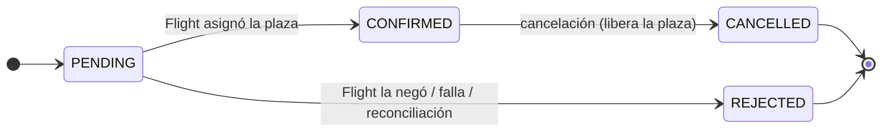
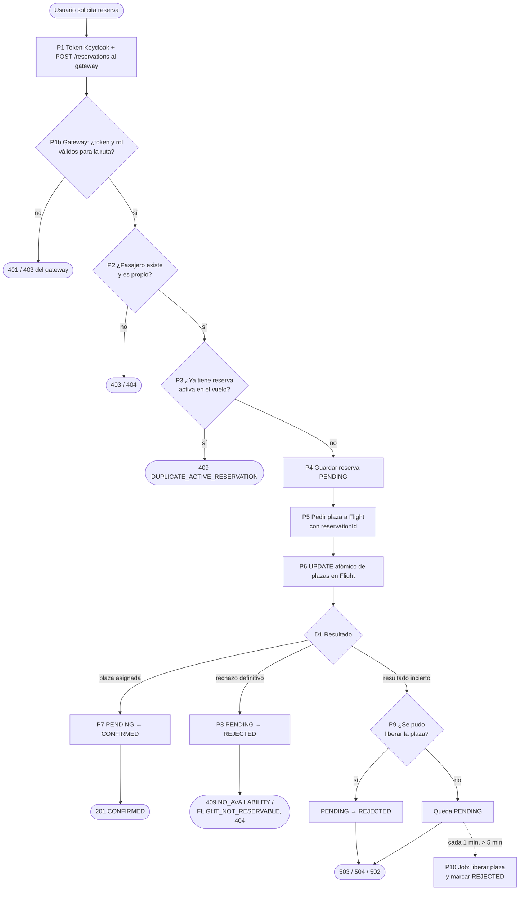
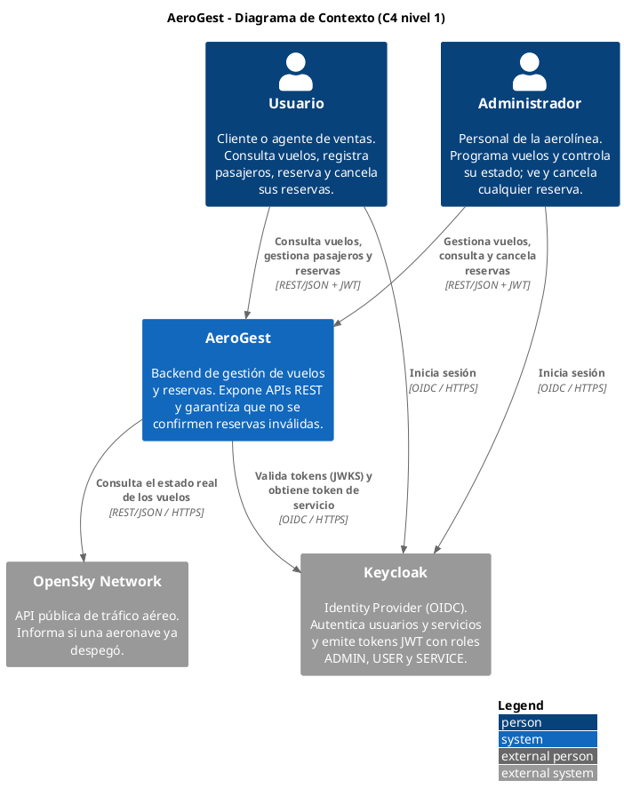
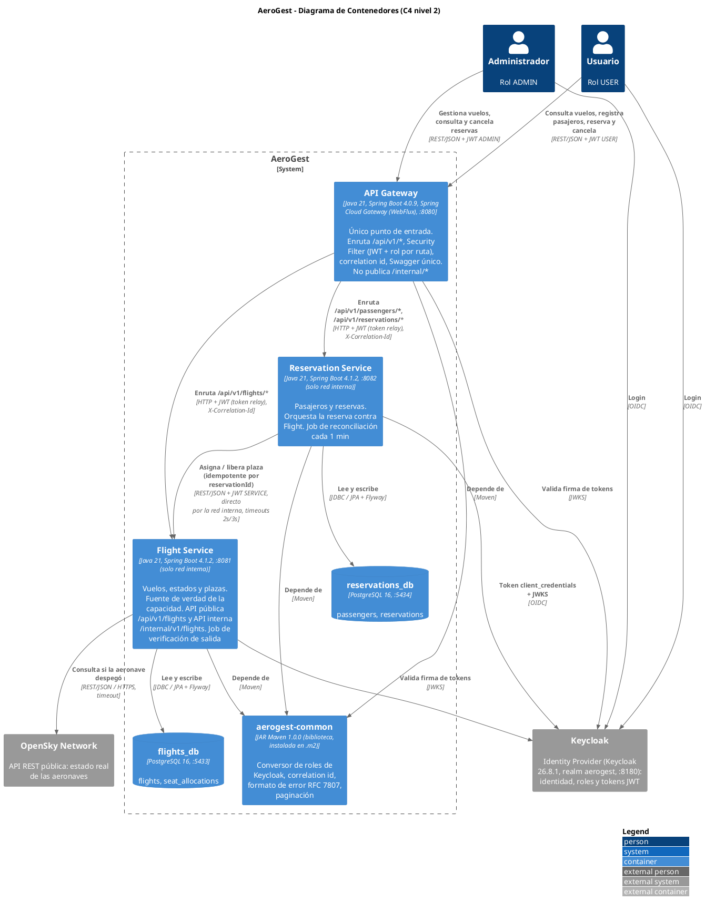
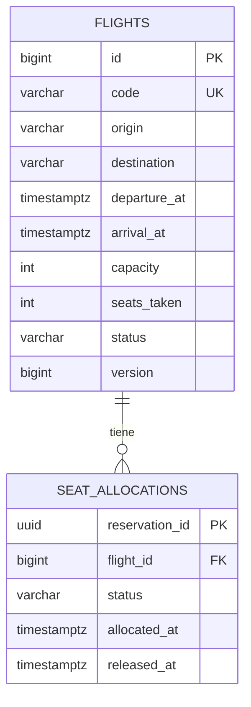
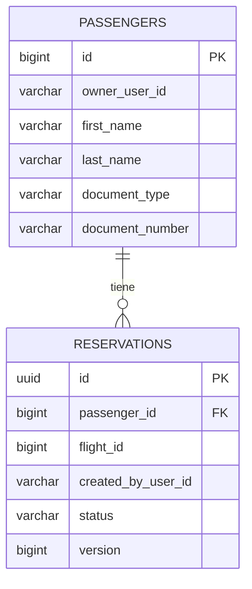

# Propuesta de desarrollo — TPI 2026 (AeroGest) — versión 2

Respuestas al formulario de propuesta, sección por sección, actualizadas con el enunciado
preliminar del 2026-10-05 y con lo implementado hasta el 2026-11-04. Los nombres (servicios,
bases, roles, reglas RN-xx, funcionalidades F-xx) son los mismos que en `docs/arquitectura.md`
y `docs/trazabilidad.md`.

> **Cómo usar este archivo:** cada `## Sección` corresponde a un campo del formulario, en el mismo
> orden. Copiar el contenido debajo de cada título en su campo. Antes de enviar: completar los
> campos marcados con **[COMPLETAR]** y adjuntar las imágenes de los diagramas de las secciones 04,
> 05, 06 y 08 (fuentes en `docs/diagramas/`). Esta tabla de cambios no va en el formulario.

**Cambios respecto de la versión 1** (`docs/propuesta-tpi-2026.md`)

| Tema | Versión 1 | Versión 2 |
|---|---|---|
| Punto de entrada | Cada servicio publicaba su puerto (8081, 8082) | **API Gateway** (Spring Cloud Gateway) en :8080 con Security Filter; los servicios no publican puertos (ADR 0005) |
| Librería común | No se implementaba | JAR **`aerogest-common` 1.0.0** instalado en el `.m2` y usado por los dos servicios y el gateway (ADR 0004) |
| Keycloak | Riesgo: confirmar si la cátedra lo aceptaba | Exigido por el enunciado; el riesgo desaparece |
| API pública externa | No había | **OpenSky Network**: verificación de la salida real del vuelo (RN-16, ADR 0006) |
| Diagramas C4 | Sin gateway ni API externa | C1 y C2 con gateway, componente común y OpenSky |
| Despliegue | `docker compose --profile apps up` | `docker compose up -d --build` levanta el sistema completo |
| Pruebas | 185 | 248 (common 11, Flight 113, Reservation 113, gateway 11) |

---

## Sección 00 — Presentación

Leído. Sin respuesta requerida.

---

## Sección 01 — Identificación

| Campo | Valor |
|---|---|
| Proyecto | **AeroGest** — Backend de gestión de vuelos y reservas |
| Equipo | **[COMPLETAR: nombre o número de grupo]** |
| Comisión | **[COMPLETAR]** |
| Integrantes | **[COMPLETAR: nombre y apellido de cada integrante]** |
| Responsable de contacto | **[COMPLETAR: nombre y correo]** |
| Repositorio principal | https://github.com/aguss0/AeroGest |

---

## Sección 02 — Descripción breve del proyecto

AeroGest es el backend de una aerolínea para administrar vuelos comerciales y las reservas de sus
pasajeros. Son dos microservicios con base PostgreSQL propia: **Flight Service** (vuelos, estados y
plazas) y **Reservation Service** (pasajeros y reservas). Un **API Gateway** es el único punto de
entrada y aplica un primer filtro de seguridad; **Keycloak** autentica usuarios y servicios con JWT
y tres roles (ADMIN, USER, SERVICE). Un JAR común (**`aerogest-common`**) reúne las convenciones del
sistema: roles, trazabilidad y formato de errores.

Está destinado al **administrador** de la aerolínea, que programa los vuelos y controla su estado, y
al **usuario** (cliente o agente de ventas), que consulta vuelos, registra pasajeros y reserva.

El principal aporte es que **nunca se confirme una reserva inválida**: sin plazas, en un vuelo
cancelado o ya despegado, duplicada o sin haber podido validar el vuelo. Se sostiene aunque lleguen
muchas solicitudes simultáneas por la última plaza y aunque Flight Service esté caído o lento, sin
transacciones distribuidas: la plaza se ocupa con una operación atómica e idempotente y la reserva
solo se confirma si esa operación tuvo éxito; ante la duda se compensa y un proceso periódico
resuelve lo pendiente. Para saber si un vuelo **ya despegó de verdad**, y no solo según su horario,
Flight Service consulta la API pública de **OpenSky Network**.

El resultado concreto es un backend que se levanta con un solo comando (Docker Compose), con APIs
REST documentadas en un Swagger único, una colección Postman con escenarios positivos y negativos,
248 pruebas automáticas (unitarias, de integración contra PostgreSQL real y de concurrencia) y
documentación de arquitectura, decisiones y trazabilidad.

*(≈ 250 palabras)*

---

## Sección 03 — Problema y contexto

**Problema actual.** Una aerolínea vende plazas de vuelos que tienen capacidad fija. Cuando la
venta se hace por varios canales a la vez, sin un registro centralizado y confiable de las plazas
ocupadas, aparecen errores costosos:

- **Sobreventa**: se confirman más reservas que asientos, porque dos ventas simultáneas ven la misma
  última plaza como libre.
- **Reservas inválidas**: se reserva en vuelos cancelados, cerrados o que ya partieron. El horario
  programado no alcanza para saberlo: un vuelo puede despegar antes de que alguien actualice su
  estado en el sistema.
- **Duplicados**: el mismo pasajero queda con dos reservas activas en el mismo vuelo.
- **Plazas "perdidas"**: una cancelación no devuelve la plaza, o la devuelve dos veces, y el
  inventario deja de coincidir con la realidad.
- **Confirmaciones sin respaldo**: se le confirma al cliente una reserva que en realidad no tiene
  plaza asignada porque la verificación falló a mitad de camino.
- **Acceso indebido**: un usuario puede ver o cancelar reservas o datos personales de pasajeros de otros.

**Causas principales.** Datos de vuelos y de reservas administrados por separado y sin una única
fuente de verdad para la capacidad; operaciones concurrentes sobre un recurso escaso; procesos que
dependen de que otro sistema responda; el estado real del vuelo vive fuera de la aerolínea (en el
tráfico aéreo) y se carga a mano; y ausencia de control de acceso por propietario.

**A quiénes afecta.** Al pasajero (llega al aeropuerto y no tiene lugar, o le cancelan una reserva
ajena), al personal de ventas (debe resolver manualmente sobreventas y reclamos) y a la aerolínea
(costos de compensación, pérdida de confianza, inventario inconsistente).

**Actores.** Administrador de la aerolínea (programa vuelos y cambia su estado), usuario/cliente o
agente (registra pasajeros, reserva y cancela), el proveedor de identidad (Keycloak) que autentica a
ambos, y OpenSky Network como fuente externa del estado real de los vuelos.

**Por qué resolverlo con el sistema propuesto.** Las reglas que evitan estos errores (capacidad,
estados del vuelo, unicidad, propiedad de los datos) deben aplicarse siempre, de forma automática y
aun bajo concurrencia o fallas; no se pueden delegar en controles manuales. Un sistema que centralice
el inventario de plazas y valide cada reserva contra él elimina la sobreventa y deja trazabilidad.

**Problema vs. solución técnica.** El problema es de negocio: *vender plazas sin sobreventa, sin
reservas inválidas y respetando quién puede ver qué*. La solución técnica (gateway, dos
microservicios, UPDATE atómico, idempotencia, compensación, Keycloak, componente común, integración
externa) se describe en las secciones 04 a 10.

---

## Sección 04 — Alcance funcional y proceso principal

### 4.1 Funcionalidades

| ID | Nombre | Actor | Comportamiento esperado | Resultado observable | Prioridad |
|---|---|---|---|---|---|
| F-01 | Alta de vuelo | ADMIN | Registra un vuelo con código, origen, destino, horarios y capacidad; valida RN-01, 02, 03, 11, 12 | 201 con el vuelo en estado `SCHEDULED`; 400/409 con `code` si viola una regla | Alta |
| F-02 | Modificación de vuelo | ADMIN | Actualiza datos de un vuelo no terminal sin bajar la capacidad por debajo de las plazas ocupadas (RN-13) | 200 con el vuelo actualizado; 409 `FLIGHT_NOT_MODIFIABLE` | Media |
| F-03 | Cambio de estado de vuelo | ADMIN | Aplica solo transiciones válidas (RN-08) | 200 con el nuevo estado; 409 `INVALID_STATUS_TRANSITION` | Alta |
| F-04 | Consulta y búsqueda de vuelos | USER, ADMIN | Busca por origen, destino, estado y rango de fechas, paginado; consulta por id | 200 con página de vuelos y plazas disponibles; 404 si no existe | Alta |
| F-05 | Registro de pasajero | USER, ADMIN | Registra un pasajero propio con documento único normalizado (RN-14) | 201; 409 `DUPLICATE_PASSENGER_DOCUMENT` | Alta |
| F-06 | Consulta y edición de pasajeros | USER, ADMIN | Lista/consulta/edita solo los pasajeros propios (ADMIN: todos) | 200; 403 si es ajeno | Media |
| F-07 | Crear reserva | USER, ADMIN | Crea la reserva `PENDING`, pide la plaza a Flight y la confirma o rechaza (RN-04, 05, 06, 09, 10) | 201 `CONFIRMED` y plaza descontada; 409/404/503/504/502 sin confirmar | Alta |
| F-08 | Consultar reservas | USER, ADMIN | Lista y consulta reservas propias (ADMIN: todas) | 200; 403 si es ajena | Alta |
| F-09 | Cancelar reserva | USER, ADMIN | Cancela una reserva `CONFIRMED` y libera la plaza una sola vez (RN-07) | 200 `CANCELLED` y plaza devuelta; 409 si ya estaba cancelada | Alta |
| F-10 | Asignar / liberar plaza (API interna) | SERVICE (Reservation Service) | Ocupa o libera una plaza de forma atómica e idempotente por `reservationId` (RN-05, RN-15) | 201/200 asignada; 409 `NO_AVAILABILITY`; 204 liberada | Alta |
| F-11 | Consulta de disponibilidad interna | SERVICE | Informa capacidad, plazas libres y si el vuelo acepta reservas | 200 `{availableSeats, acceptsReservations}` | Baja |
| F-12 | Reconciliación de reservas pendientes | Sistema (job programado) | Cada 1 min toma las `PENDING` de más de 5 min, libera su plaza y las marca `REJECTED` | No quedan reservas `PENDING` indefinidamente | Media |
| F-13 | Autenticación y autorización | Todos | Login en Keycloak, JWT con roles; el gateway valida token y rol por ruta; los servicios vuelven a validar firma, rol y propietario (`sub`) | 401 sin token, 403 sin permiso o recurso ajeno | Alta |
| F-14 | Punto de entrada único | Todos | El API Gateway enruta `/api/v1/**` al servicio que corresponde, no publica la API interna y devuelve errores propios con el formato común | Una sola URL (`:8080`); `/internal/**` → 401/403; servicio caído → 503 `UPSTREAM_UNAVAILABLE` | Alta |
| F-15 | Verificación de salida real | Sistema (job en Flight Service) + OpenSky | Consulta en OpenSky si la aeronave del vuelo ya despegó; si es así, el vuelo deja de aceptar reservas (RN-16) | El vuelo pasa a `CLOSED` aunque su horario programado no haya llegado; las reservas nuevas reciben 409 `FLIGHT_NOT_RESERVABLE` | Alta |

**Fuera del alcance:** pagos, reembolsos y facturación; check-in, embarque y equipaje; selección de
asientos individuales (se gestiona solo la cantidad de plazas); tripulación y operaciones; tarifas y
clases; notificaciones (correo/SMS); frontend propio (se usa Swagger y Postman); regla de "cancelar
solo antes de la salida" (limitación documentada); alta de usuarios desde la API (los gestiona Keycloak).

### 4.2 Reglas de negocio

| ID | Condición o disparador | Comportamiento esperado | Rechazo | Funcionalidad |
|---|---|---|---|---|
| RN-01 | Alta de vuelo | El código de vuelo es único | 409 `DUPLICATE_FLIGHT_CODE` | F-01 |
| RN-02 | Alta/modificación de vuelo | La llegada es posterior a la salida | 400 `INVALID_SCHEDULE` | F-01, F-02 |
| RN-03 | Alta/modificación de vuelo | Datos obligatorios y capacidad > 0 | 400 `VALIDATION_ERROR` / `INVALID_CAPACITY` | F-01, F-02 |
| RN-04 | Solicitud de plaza | Solo se reserva en vuelos `SCHEDULED` cuya salida es futura | 409 `FLIGHT_NOT_RESERVABLE` (reserva → `REJECTED`) | F-07, F-10 |
| RN-05 | Solicitud de plaza | Nunca más plazas ocupadas que la capacidad, aun con solicitudes simultáneas | 409 `NO_AVAILABILITY` (reserva → `REJECTED`) | F-07, F-10 |
| RN-06 | Crear reserva | Un pasajero no tiene dos reservas activas (`PENDING`/`CONFIRMED`) en el mismo vuelo | 409 `DUPLICATE_ACTIVE_RESERVATION` | F-07 |
| RN-07 | Cancelar reserva | Solo se cancela una `CONFIRMED`; la plaza se libera una sola vez | 409 `INVALID_RESERVATION_STATE` / `CONCURRENT_MODIFICATION` | F-09, F-10 |
| RN-08 | Cambio de estado | Solo transiciones válidas (ver estados abajo) | 409 `INVALID_STATUS_TRANSITION` / `INVALID_RESERVATION_STATE` | F-03, F-07, F-09 |
| RN-09 | Cualquier acceso | El rol habilita el endpoint (en el gateway y en el servicio); solo el dueño (`sub`) o ADMIN accede a pasajeros y reservas | 401 `UNAUTHENTICATED`, 403 `ACCESS_DENIED` | F-06, F-07, F-08, F-09, F-13, F-14 |
| RN-10 | Falla de Flight Service | Sin validación de Flight nunca se confirma; se compensa liberando la plaza | 503 / 504 / 502 (reserva `REJECTED` o `PENDING` hasta reconciliar) | F-07, F-12 |
| RN-11 | Alta/modificación de vuelo | Origen distinto de destino | 400 `INVALID_ROUTE` | F-01, F-02 |
| RN-12 | Alta de vuelo | La salida no puede estar en el pasado | 400 `DEPARTURE_IN_PAST` | F-01 |
| RN-13 | Modificación de vuelo | La capacidad no baja de las plazas ocupadas | 400 `INVALID_CAPACITY` | F-02 |
| RN-14 | Registro de pasajero | Tipo + número de documento (normalizado) único | 409 `DUPLICATE_PASSENGER_DOCUMENT` | F-05 |
| RN-15 | Asignar/liberar plaza | Idempotente por `reservationId`: un reintento no ocupa otra plaza | 200 (ya procesado), 409 `ALLOCATION_CONFLICT` | F-10 |
| RN-16 | OpenSky informa que la aeronave del vuelo despegó | El vuelo `SCHEDULED` pasa a `CLOSED` y deja de aceptar reservas aunque su horario programado sea futuro. Si OpenSky no responde o responde algo inesperado, no se cambia nada y rige RN-04 por horario | Las reservas posteriores: 409 `FLIGHT_NOT_RESERVABLE` | F-15, F-07 |

**Estados y transiciones**

- **Vuelo:** `SCHEDULED → CLOSED | CANCELLED`; `CLOSED → SCHEDULED | CANCELLED | COMPLETED`.
  `CANCELLED` y `COMPLETED` son terminales. `SCHEDULED → CLOSED` también lo puede
  disparar el job de OpenSky (RN-16).
- **Reserva:** `PENDING → CONFIRMED | REJECTED`; `CONFIRMED → CANCELLED`. `CANCELLED` y `REJECTED`
  son terminales. Solo `PENDING` y `CONFIRMED` son *activas*.
- **Asignación de plaza (Flight):** `ALLOCATED → RELEASED`.



### 4.3 Proceso principal: reserva de una plaza

- **Evento inicial:** un usuario autenticado solicita reservar un vuelo para uno de sus pasajeros
  (`POST /api/v1/reservations` al gateway).
- **Participantes:** Usuario, Keycloak, API Gateway, Reservation Service (+ `reservations_db`),
  Flight Service (+ `flights_db`), job de reconciliación. OpenSky participa antes,
  de forma asíncrona: cierra los vuelos que ya despegaron.
- **Resultado final:** reserva `CONFIRMED` con la plaza descontada en el vuelo, o reserva
  `REJECTED` sin plaza ocupada; en ningún caso queda una reserva confirmada sin plaza ni una plaza
  ocupada sin reserva confirmada (salvo `PENDING` transitoria que resuelve el job).

**Pasos**

| Paso | Descripción | Funcionalidades | Reglas |
|---|---|---|---|
| P1 | El usuario obtiene un token en Keycloak y envía la solicitud al gateway con `passengerId` y `flightId` | F-13 | RN-09 |
| P1b | El gateway valida el token y el rol para la ruta, asigna el `X-Correlation-Id` y reenvía a Reservation Service | F-14 | RN-09 |
| P2 | Reservation Service vuelve a validar el token y verifica formato, existencia del pasajero y que sea propio | F-07 | RN-09 |
| P3 | Verifica que no exista otra reserva activa del pasajero en el vuelo | F-07 | RN-06 |
| P4 | Guarda la reserva `PENDING` con un id propio (transacción corta) | F-07 | RN-06 (índice único), RN-08 |
| P5 | Obtiene un token de servicio (client credentials) y pide la plaza a Flight, directo por la red interna, usando el id como clave de idempotencia | F-10 | RN-15 |
| P6 | Flight ocupa la plaza con un `UPDATE` atómico condicionado a estado, fecha y capacidad | F-10 | RN-04, RN-05, RN-15, RN-16 |
| D1 | **¿Plaza asignada?** Sí → P7. Rechazo definitivo (sin plazas, no reservable, inexistente) → P8. Resultado incierto (caída, timeout, respuesta inválida) → P9 | F-07 | RN-10 |
| P7 | La reserva pasa a `CONFIRMED`; respuesta 201 | F-07 | RN-08 |
| P8 | La reserva pasa a `REJECTED`; respuesta 409/404 con `code` | F-07 | RN-04, RN-05, RN-08 |
| P9 | Compensación: se libera la plaza (idempotente). Si se pudo → `REJECTED`; si no → queda `PENDING`. Respuesta 503/504/502 | F-07, F-10 | RN-10, RN-15 |
| P10 | Cada minuto el job toma las `PENDING` de más de 5 min, libera la plaza y las marca `REJECTED` | F-12 | RN-10 |

**Excepciones relevantes:** sin token o rol inválido (401/403 en el gateway), pasajero ajeno (403),
reserva duplicada (409), sin plazas (409), vuelo cancelado/partido (409), vuelo inexistente (404),
Flight caído (503), Flight sin responder (504), respuesta inválida (502), Reservation caído (503
`UPSTREAM_UNAVAILABLE` del gateway), solicitudes simultáneas por la última plaza (solo una se confirma).

**Proceso secundario — cancelación (F-09, RN-07):** se verifica que la reserva sea propia y esté
`CONFIRMED`, se libera la plaza en Flight (idempotente) y recién entonces se marca `CANCELLED`. Si
Flight no responde, la reserva sigue `CONFIRMED` y se puede reintentar.

**Proceso secundario — verificación de salida real (F-15, RN-16):** un job de Flight
Service toma los vuelos `SCHEDULED` cuya salida programada está cerca, consulta OpenSky y cierra los
que ya despegaron. No está en el camino de la reserva: si OpenSky falla, las reservas siguen
funcionando con la regla por horario (RN-04).

**Definición textual del diagrama (Mermaid, diagrama de actividades):**



**Explicación breve:** el gateway corta lo que no tiene token o rol válido antes de llegar a un
servicio. La reserva se registra primero como `PENDING` para tener un id estable que viaja a Flight
como clave de idempotencia. La llamada a Flight queda fuera de cualquier transacción de base. Flight
es la única fuente de verdad de la capacidad y decide con una sola sentencia atómica, por lo que dos
solicitudes simultáneas nunca obtienen la misma última plaza. Reservation solo confirma si Flight
confirmó; ante la duda, compensa, y lo que no pudo compensar lo resuelve el job.

*(Representación gráfica: renderizar el bloque Mermaid en https://mermaid.live o en GitHub y adjuntar la imagen. El diagrama de secuencia equivalente está en `docs/arquitectura.md` §4.)*

---

## Sección 05 — Arquitectura: Contexto (C4 nivel 1)

**Definición textual (C4-PlantUML):**



*(Representación gráfica: renderizar en https://www.plantuml.com/plantuml o con la extensión PlantUML y adjuntar la imagen.)*

**Elementos**

| Elemento | Tipo | Descripción |
|---|---|---|
| Administrador | Persona | Rol `ADMIN`. Alta, modificación y cambio de estado de vuelos; acceso a todos los pasajeros y reservas |
| Usuario | Persona | Rol `USER`. Consulta vuelos; registra sus pasajeros; crea, consulta y cancela sus reservas |
| AeroGest | Sistema a construir | Backend con API Gateway, dos microservicios (Flight y Reservation) y sus bases |
| Keycloak | Sistema externo (Identity Provider) | Usuarios, roles, emisión y firma de tokens. Es infraestructura, no un microservicio de negocio |
| OpenSky Network | Sistema externo (API pública) | Datos de tráfico aéreo en tiempo real; AeroGest lo usa para saber si un vuelo ya despegó |

**Relaciones**

| Origen → Destino | Descripción |
|---|---|
| Administrador / Usuario → Keycloak | Se autentican y obtienen un JWT con sus roles |
| Administrador / Usuario → AeroGest | Invocan las APIs REST enviando el JWT como `Bearer` (vía Postman o Swagger) |
| AeroGest → Keycloak | Descarga las claves públicas (JWKS) para validar firmas, y Reservation Service obtiene un token de servicio con *client credentials* |
| AeroGest → OpenSky | Consulta periódica del estado de las aeronaves para detectar vuelos ya despegados |

---

## Sección 06 — Arquitectura: Contenedores (C4 nivel 2)

**Definición textual (C4-PlantUML):**



*(En C4 una biblioteca no es un contenedor en tiempo de ejecución; se dibuja porque el enunciado
pide mostrar el componente común y su relación de dependencia con los servicios.)*

**Contenedores**

| Contenedor | Tecnología | Responsabilidad |
|---|---|---|
| API Gateway | Java 21, Spring Boot 4.0.9, Spring Cloud Gateway 2025.1.4 (WebFlux), Spring Security OAuth2 Resource Server, springdoc, puerto 8080 (único publicado) | Enrutamiento, Security Filter, correlation id, errores propios (401, 403, 503, 504) con el formato común, Swagger único con los dos servicios |
| Flight Service | Java 21, Spring Boot 4.1.2 (Web MVC, Data JPA, Security OAuth2 Resource Server, Validation, Actuator, springdoc), puerto 8081 interno | CRUD de vuelos, búsqueda paginada, transiciones de estado; **inventario de plazas**: asignación y liberación atómicas e idempotentes; API interna solo para el rol `SERVICE`; cliente de OpenSky |
| Reservation Service | Mismo stack + cliente HTTP (`RestClient`) y `@Scheduled`, puerto 8082 interno | Pasajeros y reservas; control de propietario por `sub`; orquestación de la reserva (PENDING → CONFIRMED/REJECTED), compensación y job de reconciliación |
| aerogest-common | JAR Maven `ar.edu.utn.frc.aerogest:aerogest-common:1.0.0`, dependencias Spring `provided` | Convenciones transversales del sistema (ver sección 09) |
| flights_db | PostgreSQL 16, puerto 5433 | Datos exclusivos de Flight Service (esquema por migraciones Flyway) |
| reservations_db | PostgreSQL 16, puerto 5434 | Datos exclusivos de Reservation Service |
| Keycloak (externo) | Keycloak 26.8.1, puerto 8180 | Realm `aerogest`, roles `ADMIN`, `USER`, `SERVICE`; cliente público `aerogest-api` y cliente confidencial `reservation-service` |
| OpenSky Network (externo) | API REST pública por HTTPS | Estado de las aeronaves en vuelo |

**Relaciones**

- Clientes → API Gateway: HTTP REST/JSON con `Authorization: Bearer <JWT>`. Es la única URL que conocen.
- API Gateway → Flight / Reservation: reenvía la solicitud con el mismo `Authorization` (token relay)
  y el `X-Correlation-Id`. Los servicios no publican puertos fuera de la red de Docker Compose.
- Reservation → Flight: HTTP síncrono, **directo por la red interna** (no por el gateway), a
  `/internal/v1/flights/**` con token de rol `SERVICE`, `X-Correlation-Id`, timeouts de conexión 2 s
  y lectura 3 s; errores en formato RFC 7807 con `code`.
- Reservation → Keycloak: `client_credentials` (token cacheado y renovado). Gateway y servicios →
  Keycloak: descarga de claves públicas (JWKS) para validar firmas.
- Flight → OpenSky: consulta periódica por HTTPS desde un job, fuera del camino de la reserva.
- Cada servicio → su base: JPA/JDBC. **Ningún servicio accede a la base del otro.**
- Gateway, Flight y Reservation → `aerogest-common`: dependencia Maven en tiempo de compilación.

---

## Sección 07 — Arquitectura: APIs

Todos los endpoints públicos se consumen a través del gateway (`http://localhost:8080`). La API
interna de Flight no se publica: solo la usa Reservation Service por la red interna.

### Flight Service

| Microservicio | Recurso | Método HTTP | Endpoint | Operación de negocio | Seguridad |
|---|---|---|---|---|---|
| Flight | Vuelos | POST | `/api/v1/flights` | Programar un nuevo vuelo | ADMIN |
| Flight | Vuelos | GET | `/api/v1/flights?origin&destination&status&departureFrom&departureTo&page&size` | Buscar vuelos por ruta, estado y fechas (paginado) | USER, ADMIN |
| Flight | Vuelos | GET | `/api/v1/flights/{id}` | Consultar un vuelo y sus plazas disponibles | USER, ADMIN |
| Flight | Vuelos | PUT | `/api/v1/flights/{id}` | Modificar datos de un vuelo no terminal | ADMIN |
| Flight | Estado del vuelo | PATCH | `/api/v1/flights/{id}/status` | Cerrar, reabrir, cancelar o completar un vuelo | ADMIN |
| Flight | Salida real | POST | `/api/v1/flights/{id}/departure-check` | Verificar ahora en OpenSky si el vuelo ya despegó y, si es así, cerrarlo (RN-16) | ADMIN |
| Flight | Disponibilidad | GET | `/internal/v1/flights/{id}/availability` | Informar capacidad, plazas libres y si acepta reservas | SERVICE (no publicado en el gateway) |
| Flight | Asignación de plaza | POST | `/internal/v1/flights/{id}/seat-allocations` | Ocupar una plaza para una reserva (idempotente) | SERVICE (no publicado en el gateway) |
| Flight | Asignación de plaza | DELETE | `/internal/v1/flights/{id}/seat-allocations/{reservationId}` | Liberar la plaza de una reserva (idempotente) | SERVICE (no publicado en el gateway) |

### Reservation Service

| Microservicio | Recurso | Método HTTP | Endpoint | Operación de negocio | Seguridad |
|---|---|---|---|---|---|
| Reservation | Pasajeros | POST | `/api/v1/passengers` | Registrar un pasajero propio | USER, ADMIN |
| Reservation | Pasajeros | GET | `/api/v1/passengers` | Listar los pasajeros propios (ADMIN: todos) | USER, ADMIN |
| Reservation | Pasajeros | GET | `/api/v1/passengers/{id}` | Consultar un pasajero | Propietario o ADMIN |
| Reservation | Pasajeros | PUT | `/api/v1/passengers/{id}` | Corregir nombre y apellido de un pasajero | Propietario o ADMIN |
| Reservation | Reservas | POST | `/api/v1/reservations` | Reservar una plaza para un pasajero en un vuelo | USER, ADMIN (pasajero propio) |
| Reservation | Reservas | GET | `/api/v1/reservations` | Listar las reservas propias (ADMIN: todas) | USER, ADMIN |
| Reservation | Reservas | GET | `/api/v1/reservations/{id}` | Consultar una reserva | Propietario o ADMIN |
| Reservation | Reservas | POST | `/api/v1/reservations/{id}/cancel` | Cancelar una reserva confirmada y liberar su plaza | Propietario o ADMIN |

### API Gateway

| Entrada | Destino | Seguridad en el gateway |
|---|---|---|
| `GET /api/v1/flights/**` | Flight Service | USER, ADMIN |
| `POST/PUT/PATCH /api/v1/flights/**` | Flight Service | ADMIN |
| `/api/v1/passengers/**`, `/api/v1/reservations/**` | Reservation Service | USER, ADMIN (el propietario lo controla el servicio) |
| `/swagger-ui.html`, `/api-docs/flights`, `/api-docs/reservations` | Swagger único con el grupo `public` de cada servicio | Público |
| `/actuator/health` | Estado del gateway | Público |
| `/internal/**` y cualquier otra ruta | — | Denegado (401 sin token, 403 con token) |

**Errores:** RFC 7807 con `code` y `correlationId`, con el mismo formato en el gateway y en los
servicios (lo arma `aerogest-common`). Propios del gateway: 401 `UNAUTHENTICATED`, 403
`ACCESS_DENIED`, 503 `UPSTREAM_UNAVAILABLE`, 504 `UPSTREAM_TIMEOUT`.

---

## Sección 08 — Arquitectura: Persistencia

Hay **dos bases PostgreSQL 16 independientes**, una por microservicio (*database per service*). El
gateway no tiene base.

**Definición textual (Mermaid):**





**Descripción**

*flights_db — administrada por Flight Service*
- `flights`: un vuelo. `code` único; `seats_taken` es el contador de plazas ocupadas
  (`0 ≤ seats_taken ≤ capacity`); `status` ∈ {SCHEDULED, CLOSED, CANCELLED, COMPLETED}; `version`
  para bloqueo optimista en modificaciones administrativas. Para OpenSky (RN-16): `callsign` y
  `aircraft_icao24` (opcionales, juntos o ninguno, con `CHECK` de formato), `departure_checked_at`
  (última consulta válida) y `departure_detected_at` (despegue detectado). Migración `V2`.
- `seat_allocations`: una fila por reserva que pidió plaza. PK = `reservation_id` (garantiza
  idempotencia, RN-15); `status` ∈ {ALLOCATED, RELEASED}.
- Cardinalidad: un vuelo tiene 0..N asignaciones; cada asignación pertenece a 1 vuelo.

*reservations_db — administrada por Reservation Service*
- `passengers`: datos del pasajero y `owner_user_id` (claim `sub` de Keycloak del usuario que lo
  registró). Único por (`document_type`, `document_number`) normalizado (RN-14).
- `reservations`: id UUID generado por la aplicación; `flight_id` es una **referencia lógica** al
  vuelo de la otra base (sin FK); `created_by_user_id` (`sub`); `status` ∈ {PENDING, CONFIRMED,
  CANCELLED, REJECTED}; `version`.
- Cardinalidad: un pasajero tiene 0..N reservas; cada reserva pertenece a 1 pasajero.

*Relaciones entre bases (lógicas, no físicas):* `reservations.flight_id` → `flights.id` y
`reservations.id` = `seat_allocations.reservation_id`. Se mantienen por la API, no por FK.

**Decisiones de persistencia**

| Decisión | Motivo |
|---|---|
| Una base por servicio, sin acceso cruzado | Independencia de despliegue y de esquema; Reservation consulta a Flight solo por HTTP. El enunciado admite una instancia común, pero separarlas hace explícito que ningún servicio lee los datos del otro |
| Contador `seats_taken` + `UPDATE ... WHERE status='SCHEDULED' AND departure_at > now AND seats_taken < capacity` | Asigna la última plaza una sola vez sin bloqueos explícitos ni consulta previa (RN-04, RN-05) |
| PK `seat_allocations.reservation_id` | Reintentos y liberaciones idempotentes (RN-15) |
| Índice único parcial `(passenger_id, flight_id) WHERE status IN ('PENDING','CONFIRMED')` | Frena reservas activas duplicadas aunque lleguen simultáneas (RN-06) |
| `CHECK` de horarios, ruta, capacidad y plazas | Última barrera de integridad en la base (RN-02, 03, 05, 11) |
| `@Version` (bloqueo optimista) | Dos cancelaciones simultáneas: solo una cambia el estado (RN-07) |
| Sin transacción distribuida; transacciones locales cortas + compensación + reconciliación | Consistencia eventual controlada entre dos bases (ADR 0003) |
| Esquema solo por migraciones Flyway (`ddl-auto: validate`) | Esquema versionado y reproducible |
| Todas las tablas con `created_at` / `updated_at` | Auditoría básica |

---

## Sección 09 — Arquitectura: Librería común

**Se implementa un componente común: `ar.edu.utn.frc.aerogest:aerogest-common:1.0.0`** (carpeta
`common/`, ADR 0004). Es un proyecto Maven independiente que genera un JAR de biblioteca (no un
ejecutable de Spring Boot). Se instala en el repositorio local con `mvn install`
(`scripts/build-common.ps1`) y **lo declaran como dependencia en su `pom.xml` Flight Service,
Reservation Service y el API Gateway**. No se copia código entre proyectos.

**Qué contiene** (convenciones del sistema, no reglas de un servicio)

| Paquete | Clase | Para qué |
|---|---|---|
| `common.security` | `KeycloakRealmRoleConverter` | Convierte `realm_access.roles` del token de Keycloak en `ROLE_xxx`. Lo usan los dos servicios y el gateway, así los tres interpretan los roles igual |
| `common.web` | `CorrelationId`, `CorrelationIdFilter` | Nombre del encabezado `X-Correlation-Id`, clave del log (MDC) y filtro que lo propaga |
| `common.web` | `PageResponse<T>` | Formato JSON estable de las páginas |
| `common.web` | `ServletProblemWriter` | Escribe los 401/403 de Spring Security con el formato común |
| `common.error` | `ProblemResponses`, `FieldIssue` | Formato único de error (RFC 7807 + `code` + `correlationId`) para controladores, seguridad y gateway |
| `common.autoconfigure` | `AerogestCommonAutoConfiguration` | Con solo agregar la dependencia, registra el filtro de correlation id (solo en aplicaciones servlet; no en el gateway, que es reactivo) |

**Qué queda en cada servicio, a propósito**

| Elemento | Motivo |
|---|---|
| `ErrorCode` y su mapeo a status HTTP, `BusinessRuleException` | Son el contrato propio de cada API |
| `SecurityConfig` (matriz de roles por endpoint) | Cada servicio decide quién usa cada endpoint |
| `@RestControllerAdvice` | Cada servicio decide qué excepciones traduce y cómo |
| Entidades, reglas de dominio, repositorios, DTOs, cliente HTTP de Flight | Pertenecen a cada bounded context; compartirlos acoplaría los modelos |
| DTOs de la API interna de Flight | El contrato entre servicios es el JSON documentado en OpenAPI, no clases Java |

Si las reglas de negocio estuvieran en el JAR, un cambio en un servicio obligaría a publicar una
versión nueva del componente y a actualizar a todos sus consumidores.

**Decisiones de diseño del componente**
- Dependencias de Spring con alcance `provided`: cada consumidor aporta su versión. Se compila
  contra la versión de Spring Boot más baja que lo usa (4.0.x, la del gateway) y funciona en los tres.
- Versionado: un cambio que rompa compatibilidad sube la versión y cada servicio la adopta cuando quiere.
- En Docker, cada imagen instala primero `common/` en su propio `.m2` y después compila el servicio:
  es el mismo mecanismo que en desarrollo y la construcción no depende de la máquina del desarrollador.
- 11 pruebas propias en `common/`.

**Alternativas descartadas:** copiar el código (lo excluye el enunciado y las copias divergen); un
manejador de excepciones base en el JAR (mete comportamiento implícito y acopla cómo traduce cada
servicio sus errores); un pom agregador multi-módulo (oculta que el componente es un artefacto
independiente que se consume por versión).

---

## Sección 10 — Seguridad y autorización

**Mecanismo de autenticación.** OAuth 2.0 / OpenID Connect con **Keycloak 26** (realm `aerogest`),
JWT y Spring Security en el gateway y en los dos servicios.
- Usuarios: inician sesión en Keycloak con el cliente público `aerogest-api`. En Swagger
  (`:8080/swagger-ui.html`, *Authorize* → `keycloak`) es el flujo OIDC estándar, **authorization
  code + PKCE**: el usuario escribe su contraseña en la página de Keycloak, nunca en AeroGest. Postman y
  los scripts usan *password grant*, habilitado solo para automatizar la demostración.
- Servicio a servicio: Reservation Service usa el cliente confidencial `reservation-service` con
  **client credentials**; el token se cachea y se renueva 30 s antes de vencer.
- Gateway, Flight y Reservation son **resource servers**: validan firma (JWKS), emisor y
  vencimiento del token. No comparten secretos entre sí. Tokens de 30 minutos.

**Integración con el API Gateway (Security Filter).** El gateway es la primera barrera: valida el
JWT y autoriza **por rol y ruta** antes de reenviar. Reenvía el `Authorization` sin cambios (token
relay) y no agrega encabezados de identidad. Deniega `/internal/**` y cualquier ruta no publicada.

**Trusted zone** (ADR 0005)

| Tráfico | Cómo se protege |
|---|---|
| Cliente → sistema | Solo por el gateway (:8080). Los servicios no publican puertos fuera de la red de Docker Compose |
| Gateway → servicio | Los servicios **vuelven a validar el JWT** y su rol; estar dentro de la red no alcanza |
| Reservation → Flight | Directo por la red interna, con token propio de rol `SERVICE`. Flight solo acepta ese rol en `/internal/**` |
| Datos de cada usuario | Reservation decide por el `sub` del token quién accede a cada pasajero y reserva. El gateway no puede hacerlo porque depende de los datos |
| Keycloak | Fuera del gateway: el cliente obtiene el token directo de Keycloak (:8180) |

Se descartó que los servicios confíen en encabezados puestos por el gateway (`X-User-Id`, `X-Roles`):
cualquier contenedor de la red podría falsificarlos y se perdería la segunda barrera. Validar un JWT
es barato porque la clave pública queda en caché.

**Roles y permisos** (claim `realm_access.roles`)

| Rol | Permisos |
|---|---|
| `ADMIN` | Crear, modificar y cambiar el estado de vuelos; ver y cancelar pasajeros y reservas de cualquier usuario |
| `USER` | Consultar vuelos; registrar y ver **sus** pasajeros; crear, ver y cancelar **sus** reservas |
| `SERVICE` | Solo la API interna de Flight (`/internal/**`), por la red interna; no entra a nada por el gateway |
| Anónimo | Solo `/actuator/health` y Swagger |

**Recursos protegidos.** Todos los endpoints `/api/v1/**` y `/internal/v1/**`. Tres niveles:
1. **Gateway, por rol y ruta**: corta antes de llegar al servicio.
2. **Servicio, por rol** (en su `SecurityConfig`): habilita o no el endpoint.
3. **Servicio, por propietario**: pasajeros y reservas guardan el `sub` del usuario; solo ese
   usuario o un ADMIN puede leerlos o modificarlos (RN-09).

**Comportamiento ante accesos no autorizados**
- Sin token, token vencido o firma inválida → **401** `UNAUTHENTICATED` (del gateway).
- Rol insuficiente para la ruta → **403** `ACCESS_DENIED` (del gateway).
- Recurso ajeno → **403** `ACCESS_DENIED` (del servicio).
- Formato RFC 7807 con `code` y `correlationId`; no se revela información del recurso ajeno.

**Cómo comprobarlo**

| Caso | Acción | Resultado esperado |
|---|---|---|
| Permitido | `user1` obtiene token y hace `GET :8080/api/v1/reservations/{id}` de **su** reserva | 200 con la reserva |
| Permitido | `admin` hace `POST :8080/api/v1/flights` con datos válidos | 201 |
| Rechazado | `user2` hace `GET :8080/api/v1/reservations/{id}` de la reserva de `user1` | 403 `ACCESS_DENIED` (del servicio) |
| Rechazado | `user1` hace `POST :8080/api/v1/flights` | 403 (del gateway) |
| Rechazado | Cualquier endpoint de negocio sin `Authorization` | 401 (del gateway) |
| Rechazado | Token `SERVICE` contra `:8080/api/v1/reservations`, o token `USER` contra `:8080/internal/**` | 403 (del gateway) |

Se verifica en las carpetas 00–04 de la colección Postman y en pruebas automáticas
(`ApiGatewayIntegrationTest`, `…sinCredencialesDevuelve401`,
`…unUsuarioNoPuedeVerNiCancelarUnaReservaAjena_403`, `…elRolServiceNoTieneAccesoALaApiPublica_403`).

---

## Sección 10 — Ejecución y despliegue

**Tecnologías y versiones**

| Componente | Versión |
|---|---|
| Java | 21 |
| Spring Boot (Flight, Reservation) | 4.1.2 (Web MVC, Data JPA, Validation, Security OAuth2 Resource Server, Actuator) |
| Spring Boot (API Gateway) | 4.0.9 + Spring Cloud 2025.1.4 (Spring Cloud Gateway WebFlux). La versión de Spring Cloud para Boot 4.1 estaba en RC; cada servicio se despliega por separado y puede tener su propia versión |
| aerogest-common | 1.0.0 (JAR Maven, instalado en el `.m2`) |
| springdoc-openapi | 3.0.3 (Swagger UI) |
| Flyway | la gestionada por Spring Boot 4.1.2 |
| PostgreSQL | 16 (imagen `postgres:16`) |
| Keycloak | 26.8.1 (`quay.io/keycloak/keycloak:26.8.1`, modo `start-dev`) |
| Build | Maven Wrapper (`mvnw`) |
| Pruebas | JUnit 5, Mockito, Spring Security Test, Testcontainers (PostgreSQL) |
| Contenedores | Docker Desktop + Docker Compose; Dockerfiles multi-etapa (contexto en la raíz del repositorio) |
| Colección | Postman / Newman 6.2.1 |

**Dependencias de infraestructura.** Dos PostgreSQL (puertos 5433 y 5434) y Keycloak (8180). Para
las pruebas automáticas, Docker en ejecución (Testcontainers levanta su propio PostgreSQL).
Acceso a Internet para OpenSky; queda fuera del despliegue, como permite el enunciado.

**Configuración por entorno.** Todo se parametriza con variables de entorno, sin secretos en el
código. `.env.example` (versionado) documenta cada variable: URLs y credenciales de las bases, URLs
de Keycloak (issuer, JWKS, token), secreto del cliente `reservation-service`, contraseñas de los
usuarios de demostración, puerto del gateway y URLs de destino, URL de Flight y timeouts de la
integración. El `.env` real no se versiona. Docker Compose lo lee automáticamente; para correr con
Maven se carga con `scripts/load-env.ps1`. Dentro de Docker, Compose sobrescribe las URLs para usar
los nombres de servicio de la red interna.

**Procedimiento de arranque**

```powershell
cd aerogest
Copy-Item .env.example .env          # y cambiar las claves
docker compose up -d --build
```

Levanta las dos bases, Keycloak, los dos microservicios y el API Gateway. Listo cuando responden
`http://localhost:8180/realms/aerogest` y `http://localhost:8080/actuator/health`; Swagger en
`http://localhost:8080/swagger-ui.html`. Apagar: `docker compose down` (`-v` para bases limpias).

Alternativas:
- Solo infraestructura para depurar desde el IDE: `docker compose up -d flights-db reservations-db keycloak`,
  `.\scripts\build-common.ps1` y cada servicio con `.\mvnw.cmd spring-boot:run`.
- Diagnóstico de la API interna: `docker compose -f docker-compose.yml -f docker-compose.debug.yml up -d`
  publica 8081 y 8082 solo en `127.0.0.1` (no es parte del despliegue).

**Archivos que permiten ejecutar el backend completo**

| Archivo | Rol |
|---|---|
| `docker-compose.yml` | Dos PostgreSQL, Keycloak, Flight, Reservation y API Gateway |
| `docker-compose.debug.yml` | Opcional: publica los puertos de los servicios en `127.0.0.1` |
| `api-gateway/Dockerfile`, `flight-service/Dockerfile`, `reservation-service/Dockerfile` | Build multi-etapa (instala `common/` → compila el servicio → JRE 21) |
| `common/` | Fuente del componente común `aerogest-common` |
| `.env.example` | Plantilla de configuración |
| `keycloak/aerogest-realm.json` | Realm, roles, clientes y usuarios de demostración (se importa al arrancar) |
| `*/src/main/resources/db/migration/` | Migraciones Flyway que crean el esquema al iniciar cada servicio |
| `README.md` | Instrucciones paso a paso |
| `scripts/` | Carga del `.env`, instalación del componente común, obtención de tokens, smoke tests y ejecución de la colección |

---

## Sección 10 — Colección de endpoints y escenarios de prueba

**Herramienta.** Colección **Postman** (`postman/AeroGest.postman_collection.json`) + entorno
(`postman/aerogest-local.postman_environment.json`). Se ejecuta desde Postman (*Run collection*) o
por consola con Newman (`scripts/run-postman.ps1`). Cada solicitud tiene *tests* que validan código
HTTP, `code` de error y efecto (por ejemplo, plazas disponibles antes y después). Todas las
solicitudes de negocio van al gateway.

**Organización (carpetas, en orden de ejecución)**

| Carpeta | Contenido |
|---|---|
| 00 Autenticación | Tokens de `admin`, `user1`, `user2` y del cliente `reservation-service` |
| 01 Vuelos | Alta, duplicado, validaciones, consulta, búsqueda, inexistente, transición inválida, la API interna no se publica en el gateway |
| 02 Pasajeros | Registro, documento duplicado, datos inválidos, acceso a pasajero ajeno |
| 03 Reservas (proceso principal) | Reserva confirmada, plaza descontada, duplicada, pasajero/reserva ajenos, vuelo inexistente, 401/403 |
| 04 Cancelación | Cancelación ajena, cancelación correcta, plaza liberada, cancelación repetida, nueva reserva |
| 05 Vuelo no reservable | Reservar en un vuelo cancelado → 409 |
| 06 Capacidad agotada | Vuelo de capacidad 1: primera confirmada, segunda rechazada |
| 07 [Manual] Flight apagado | `docker stop` → 503 y reserva no confirmada |
| 08 [Manual] Flight sin responder | `docker pause` → 504 y reserva no confirmada |
| 09 [Internet] OpenSky | Avión real en el aire → vuelo `CLOSED` y reserva 409; otro callsign, USER, datos de aeronave inválidos, vuelo sin aeronave |

**Variables de entorno.** `gatewayUrl` (`http://localhost:8080`), `keycloakUrl` y las claves
`adminPassword`, `userPassword`, `reservationClientSecret` (se completan desde el `.env`, no se
versionan). Variables de colección generadas en ejecución: tokens, ids de vuelos, pasajeros y
reservas, y un sufijo aleatorio para códigos de vuelo y documentos.

**Autenticación.** La carpeta 00 obtiene los tokens de Keycloak y los guarda en variables; cada
solicitud usa `Bearer {{tokenUser1}}`, `{{tokenAdmin}}`, etc., según el actor del escenario.

**Datos iniciales.** Usuarios y roles los importa Keycloak desde `keycloak/aerogest-realm.json`. Los
vuelos y pasajeros los crea la propia colección con datos únicos por corrida, por lo que se puede
repetir sin limpiar las bases.

**Orden de ejecución.** 00 → 06 en secuencia (cada carpeta usa ids generados por las anteriores).
07 y 08 son manuales: indican qué comando de Docker ejecutar antes y después.

**Escenarios positivos:** alta y consulta de vuelo; cambio de estado válido; registro de pasajero;
reserva confirmada con plaza descontada; consulta de reservas propias y de todas como ADMIN;
cancelación con plaza devuelta; nueva reserva tras cancelar.

**Escenarios negativos:**
- *Reglas de negocio:* código duplicado (RN-01), horarios inválidos (RN-02), capacidad 0 (RN-03),
  origen = destino (RN-11), transición inválida (RN-08), documento duplicado (RN-14), reserva
  duplicada (RN-06), vuelo cancelado (RN-04), capacidad agotada (RN-05), cancelación repetida (RN-07).
- *Seguridad:* sin token (401), USER crea vuelo (403), SERVICE en API pública (403), USER en API
  interna a través del gateway (403), pasajero/reserva ajenos (403).
- *Integraciones:* Flight apagado (503), Flight sin responder (504), vuelo inexistente validado
  contra Flight (404); en todos los casos se verifica que la reserva **no** quedó `CONFIRMED`.
- *API externa (carpeta 09, necesita Internet):* busca en OpenSky un avión en el aire, crea un vuelo
  con su callsign e icao24, `departure-check` lo cierra (`DEPARTURE_DETECTED`), la reserva da 409
  `FLIGHT_NOT_RESERVABLE`; mismo avión con otro callsign (`OTHER_FLIGHT`), USER (403), callsign sin
  icao24 (400) y vuelo sin aeronave (409). Las fallas de OpenSky se prueban con JUnit.

Complementos: smoke tests PowerShell (`scripts/smoke-reservations.ps1`, incluye 10 reservas
simultáneas por la última plaza; `scripts/smoke-flights.ps1`) y 248 pruebas JUnit.

---

## Sección 11 — Alcance acordado, desafíos y exclusiones

**Proceso central que quedará funcionando.** Reserva de plaza de punta a punta a través del gateway
y entre dos microservicios: el usuario reserva para su pasajero, Flight Service ocupa la plaza de
forma atómica e idempotente y Reservation Service confirma o rechaza; cancelación que devuelve la
plaza una sola vez; reconciliación automática de reservas pendientes; cierre de
vuelos ya despegados según OpenSky.

**Funcionalidades obligatorias:** F-01, F-03, F-04, F-05, F-07, F-08, F-09, F-10, F-12, F-13, F-14,
F-15 (prioridad alta/media de la sección 04). Complementarias: F-02, F-06, F-11.

**Integraciones relevantes**
- Cliente → API Gateway → Flight / Reservation (enrutamiento, Security Filter, token relay,
  correlation id, errores propios 401/403/503/504).
- Reservation Service → Flight Service (HTTP síncrono por la red interna, token `SERVICE`,
  idempotencia, timeouts, clasificación de errores, compensación, correlation id).
- Gateway y servicios → Keycloak (validación de JWT; client credentials).
- Flight Service → OpenSky Network (job periódico, timeouts, tolerancia a fallas).

**Integración con la API pública externa (OpenSky Network).** Respuesta a lo que pide el enunciado.
Detalle y alternativas descartadas en `docs/adr/0006-integracion-opensky-salida-real.md`; corrida
real en `docs/evidencias/opensky-en-vivo.md`.

| Pregunta del enunciado | Respuesta |
|---|---|
| ¿Qué API? | **OpenSky Network**, `GET https://opensky-network.org/api/states/all`, API REST pública y gratuita con el estado de las aeronaves en tiempo real. Acceso anónimo (sin cuenta ni secretos), 400 créditos por día |
| ¿Por qué se necesita externamente? | Si un vuelo ya despegó no es un dato que la aerolínea defina: ocurre en el mundo real. Hoy RN-04 lo aproxima con el horario programado, que falla cuando el vuelo sale antes o cuando nadie actualiza el estado a mano |
| ¿Qué proceso depende de ella? | La reserva (F-07): un vuelo que ya despegó no puede aceptar reservas. La información de OpenSky cierra el vuelo (RN-16) y a partir de ahí el `UPDATE` atómico de Flight rechaza las nuevas solicitudes |
| ¿Cómo se integra? | Un job de **Flight Service** (dueño del estado del vuelo) corre cada 5 min, toma los vuelos `SCHEDULED` con aeronave asignada cuya salida programada está entre ahora − 6 h y ahora + 2 h y hace **una sola consulta** con todos sus `icao24` (1 crédito; 288 por día). Si la aeronave está en el aire con el callsign del vuelo, lo pasa a `CLOSED`. El ADMIN puede forzarlo con `POST /api/v1/flights/{id}/departure-check`. Cliente HTTP del JDK con timeouts de 3 s (conexión) y 5 s (respuesta). No está en el camino de la reserva: la latencia y la disponibilidad de una reserva no dependen de OpenSky |
| ¿Qué información se usa? | De cada aeronave: `icao24` (identifica el avión), `callsign` (identifica el vuelo que está haciendo; el mismo avión hace varios tramos por día) y `on_ground`. El vuelo guarda su `callsign` y `aircraftIcao24`, que carga el ADMIN |
| ¿Qué pasa si no responde o responde algo inesperado? | No se cambia el estado del vuelo y rige RN-04 por horario. El job lo registra en el log y reintenta en la próxima corrida; ante un 429 no vuelve a consultar hasta lo que indica `X-Rate-Limit-Retry-After-Seconds`. Una respuesta mal formada se rechaza entera. El endpoint manual responde 503 `OPENSKY_UNAVAILABLE` / `OPENSKY_RATE_LIMITED`, 504 `OPENSKY_TIMEOUT` o 502 `OPENSKY_INVALID_RESPONSE`. Nunca se cierra un vuelo sin una respuesta válida |

**Desafíos técnicos y funcionales**
- Consistencia entre dos bases **sin transacción distribuida** (reserva PENDING → plaza → CONFIRMED,
  compensación y reconciliación).
- **Concurrencia** por la última plaza: N solicitudes simultáneas, solo una confirmada.
- **Resultados inciertos** de la integración (caída, timeout, respuesta inválida): nunca confirmar
  sin certeza y no dejar plazas ocupadas huérfanas.
- **Idempotencia** de asignación y liberación ante reintentos.
- Seguridad en capas: el gateway por rol y ruta, los servicios por rol y por propietario, y una
  trusted zone que no confía solo en la red.
- Componente común que comparta convenciones sin acoplar las reglas de negocio de cada servicio.
- Usar un dato externo para una regla de negocio sin que su caída afecte la reserva.

**Exclusiones expresas.** Pagos, reembolsos, facturación, check-in, embarque, equipaje, asientos
individuales, tarifas/clases, tripulación, notificaciones, frontend, gestión de usuarios desde la
API, regla de cancelación "antes de la salida", alta disponibilidad / escalado horizontal,
mensajería asíncrona (colas) y descubrimiento de servicios (Eureka): las rutas del gateway son fijas.

**Riesgos y dependencias**

| Riesgo / dependencia | Impacto | Mitigación |
|---|---|---|
| OpenSky con límite de uso, cambios de autenticación o caído durante la defensa | La verificación de salida no se puede mostrar en vivo | La reserva no depende de OpenSky (rige RN-04); pruebas con un doble del cliente HTTP; evidencia guardada de una corrida real |
| Encontrar vuelos reales que coincidan con los vuelos de la demo | El caso positivo es difícil de reproducir | La carpeta 09 de Postman busca en OpenSky un avión en el aire al momento de probar y crea el vuelo con sus datos |
| Keycloak en `start-dev` tarda 1–3 min en arrancar y no persiste datos | Demo más lenta; realm se reimporta | Levantar 15 min antes; realm versionado en JSON |
| Recursos de la máquina (6 contenedores + Testcontainers) | Arranque lento o fallas en la defensa | Ejecución alternativa con Maven; evidencias guardadas como plan B |
| Escenarios de falla (07/08) dependen de comandos Docker manuales | Error humano en la demo | Script `smoke-reservations.ps1 -IncludeFailures` los automatiza |
| Versiones distintas de Spring Boot entre gateway (4.0.9) y servicios (4.1.2) | Incompatibilidad del componente común | `aerogest-common` se compila contra 4.0.x con dependencias `provided`; probado en los tres |
| Autorización por rol en dos lugares (gateway y servicio) | Que las matrices diverjan al agregar un endpoint | Pruebas de seguridad de cada lado (`ApiGatewayIntegrationTest` y las de cada servicio) |

---

## Sección 11 — Criterios de verificación propuestos

| # | Condición inicial | Acción | Resultado esperado | Relación |
|---|---|---|---|---|
| CV-1 | Sistema levantado con `docker compose up -d --build`; vuelo `SCHEDULED` con capacidad 2; `user1` con un pasajero propio | `user1` hace `POST :8080/api/v1/reservations` y se busca el `X-Correlation-Id` de la respuesta en los logs | 201 `CONFIRMED`; `GET :8080/api/v1/flights/{id}` muestra `availableSeats` 2 → 1; el mismo id aparece en el gateway, en Reservation y en Flight | F-07, F-10, F-14, RN-04, RN-05; `POST /api/v1/reservations`; Postman 03 |
| CV-2 | Vuelo con 1 plaza libre; 10 pasajeros distintos | 10 reservas simultáneas al mismo vuelo | Exactamente 1 `CONFIRMED` y 9 `REJECTED` (409 `NO_AVAILABILITY`); `availableSeats` = 0, nunca negativo | F-07, F-10, RN-05; `smoke-reservations.ps1`, `SeatAllocationIntegrationTest` |
| CV-3 | Reserva `CONFIRMED` de `user1` | `user1` hace `POST :8080/api/v1/reservations/{id}/cancel` dos veces | 1ª: 200 `CANCELLED` y plaza devuelta (1 → 2); 2ª: 409 y la plaza sigue en 2 | F-09, RN-07; Postman 04 |
| CV-4 | Pasajero con reserva activa en el vuelo A; vuelo B en estado `CANCELLED` | Repetir la reserva en A; reservar en B | A: 409 `DUPLICATE_ACTIVE_RESERVATION` y la plaza no se descuenta. B: 409 `FLIGHT_NOT_RESERVABLE` y la reserva queda `REJECTED` | F-03, F-07, RN-04, RN-06, RN-08; Postman 03 y 05 |
| CV-5 | Reserva de `user1`; tokens de `user1`, `user2` y del cliente `reservation-service` | `user2` consulta esa reserva; SERVICE llama a `/api/v1/reservations`; `user1` llama a `:8080/internal/v1/flights/{id}/availability`; petición sin token | 403 `ACCESS_DENIED` (servicio), 403 (gateway), 403 (gateway: la API interna no se publica) y 401 (gateway), todos en formato RFC 7807 | F-13, F-14, RN-09; Postman 00–04, `ApiGatewayIntegrationTest` |
| CV-6 | Flight Service detenido (`docker stop`) o congelado (`docker pause`) | `user1` intenta reservar | 503 / 504; la reserva no queda `CONFIRMED` (`REJECTED` o `PENDING` que el job pasa a `REJECTED` en ≤ 6 min tras volver Flight) | F-07, F-12, RN-10; Postman 07/08, `smoke-reservations.ps1 -IncludeFailures` |
| CV-7 | Vuelo `SCHEDULED` con salida programada futura y la aeronave (callsign + icao24) de un avión que OpenSky muestra en el aire | `POST :8080/api/v1/flights/{id}/departure-check` (o corre el job); luego `user1` intenta reservar | `result = DEPARTURE_DETECTED`, el vuelo pasa a `CLOSED`; la reserva recibe 409 `FLIGHT_NOT_RESERVABLE` | F-15, RN-16; Postman 09, `evidencias/opensky-en-vivo.md` |
| CV-8 | OpenSky inaccesible o con respuesta inválida | Verificación manual de un vuelo con aeronave; luego `user1` reserva en ese vuelo | 503/504/502 con `code` `OPENSKY_*`; el vuelo no cambia de estado y la reserva se confirma normalmente (rige RN-04 por horario) | F-15, RN-16, RN-04; `DepartureVerificationIntegrationTest` |
