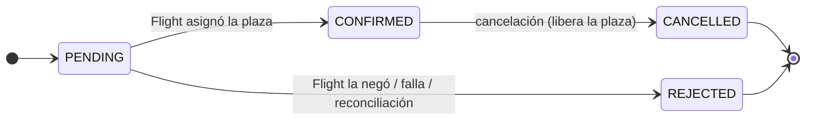
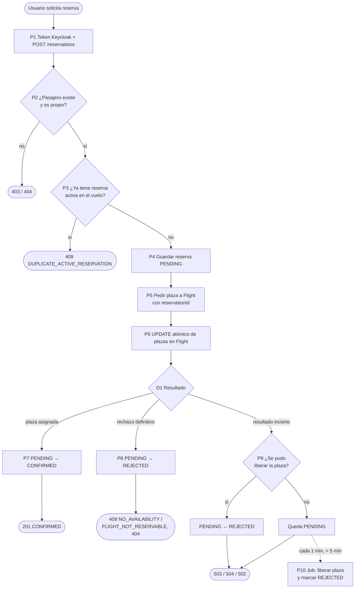
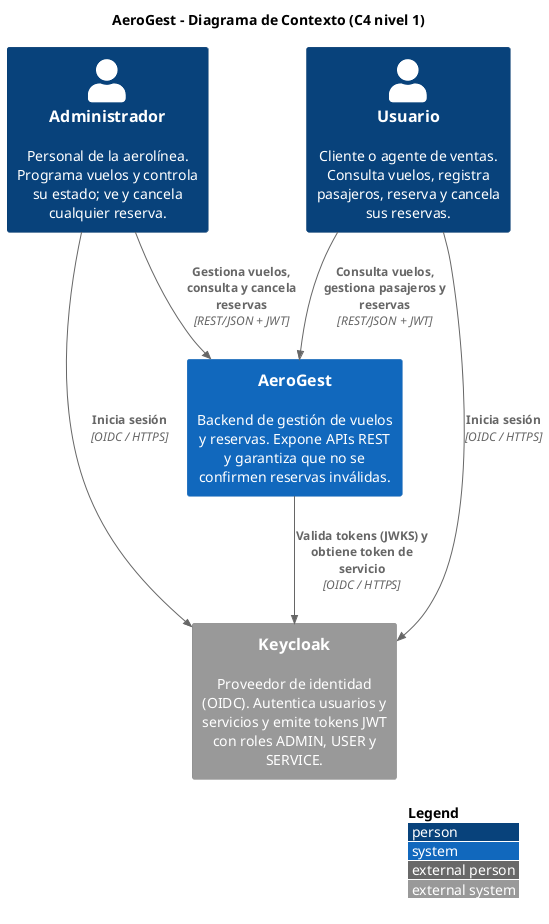
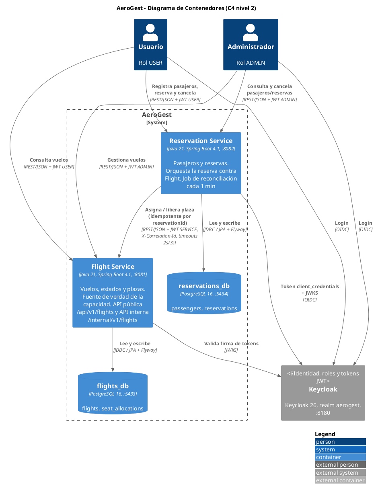
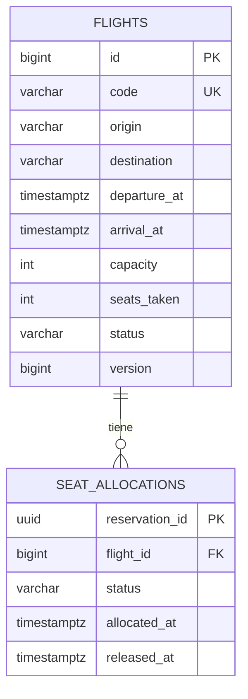
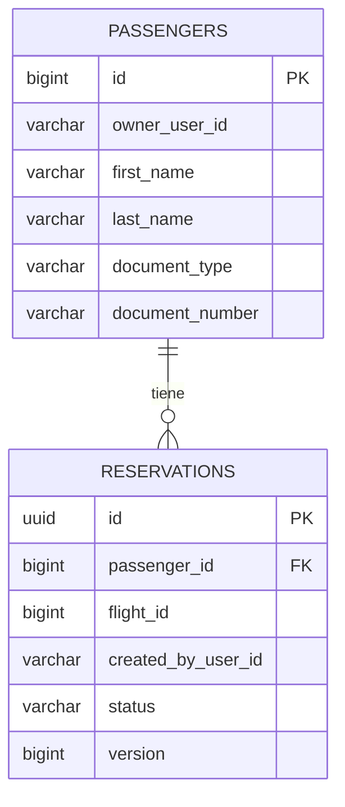

# Propuesta de desarrollo — TPI 2026 (AeroGest)

Respuestas al formulario de propuesta, sección por sección. Los nombres (servicios, bases, roles,
reglas RN-xx, funcionalidades F-xx) son los mismos que en `docs/arquitectura.md` y `docs/trazabilidad.md`.

> Completar los campos marcados con **[COMPLETAR]**.

---

## Sección 00 — Presentación

Leído. Sin respuesta requerida.

---

## Sección 01 — Identificación

| Campo | Valor |
|---|---|
| Proyecto | **AeroGest** — Backend de gestión de vuelos y reservas |
| Equipo | **[COMPLETAR: nombre o número de grupo]** |
| Comisión | **[COMPLETAR]** |
| Integrantes | **[COMPLETAR: nombre y apellido de cada integrante]** |
| Responsable de contacto | **[COMPLETAR: nombre y correo]** |
| Repositorio principal | https://github.com/aguss0/AeroGest |

---

## Sección 02 — Descripción breve del proyecto

AeroGest es el backend de una aerolínea para administrar vuelos comerciales y las reservas de sus
pasajeros. Está construido como dos microservicios independientes: **Flight Service**, que gestiona
los vuelos, sus estados y la cantidad de plazas, y **Reservation Service**, que gestiona pasajeros y
reservas. Cada uno tiene su propia base PostgreSQL, y la identidad de usuarios y servicios la
resuelve **Keycloak** con tokens JWT y tres roles (ADMIN, USER, SERVICE).

Está destinado a dos tipos de usuarios: el **administrador** de la aerolínea, que da de alta los
vuelos y controla su estado, y el **usuario** (cliente o agente de ventas), que consulta vuelos,
registra pasajeros y reserva.

El principal aporte es garantizar que **nunca se confirme una reserva inválida**: sin plazas, en un
vuelo cancelado o ya partido, duplicada para el mismo pasajero, o sin haber podido validar el vuelo.
Esto se sostiene aunque lleguen muchas solicitudes simultáneas por la última plaza y aunque el
servicio de vuelos esté caído o tarde en responder, sin usar transacciones distribuidas: la plaza se
ocupa con una operación atómica e idempotente en Flight Service y la reserva solo pasa a CONFIRMED
cuando esa operación tuvo éxito; ante un resultado incierto se compensa y un proceso periódico
resuelve las reservas que hayan quedado pendientes.

El resultado concreto es un backend ejecutable con un solo comando (Docker Compose), con APIs REST
documentadas en Swagger, una colección Postman con escenarios positivos y negativos, más de 180
pruebas automáticas (unitarias, de integración contra PostgreSQL real y de concurrencia) y
documentación de arquitectura, decisiones y trazabilidad de cada regla de negocio.

*(≈ 260 palabras)*

---

## Sección 03 — Problema y contexto

**Problema actual.** Una aerolínea vende plazas de vuelos que tienen capacidad fija. Cuando la
venta se hace por varios canales a la vez, sin un registro centralizado y confiable de las plazas
ocupadas, aparecen errores costosos:

- **Sobreventa**: se confirman más reservas que asientos, porque dos ventas simultáneas ven la misma
  última plaza como libre.
- **Reservas inválidas**: se reserva en vuelos cancelados, cerrados o que ya partieron.
- **Duplicados**: el mismo pasajero queda con dos reservas activas en el mismo vuelo.
- **Plazas "perdidas"**: una cancelación no devuelve la plaza, o la devuelve dos veces, y el
  inventario deja de coincidir con la realidad.
- **Confirmaciones sin respaldo**: se le confirma al cliente una reserva que en realidad no tiene
  plaza asignada porque la verificación falló a mitad de camino.
- **Acceso indebido**: un usuario puede ver o cancelar reservas o datos personales de pasajeros de otros.

**Causas principales.** Datos de vuelos y de reservas administrados por separado y sin una única
fuente de verdad para la capacidad; operaciones concurrentes sobre un recurso escaso; procesos que
dependen de que otro sistema responda; y ausencia de control de acceso por propietario.

**A quiénes afecta.** Al pasajero (llega al aeropuerto y no tiene lugar, o le cancelan una reserva
ajena), al personal de ventas (debe resolver manualmente sobreventas y reclamos) y a la aerolínea
(costos de compensación, pérdida de confianza, inventario inconsistente).

**Actores.** Administrador de la aerolínea (programa vuelos y cambia su estado), usuario/cliente o
agente (registra pasajeros, reserva y cancela) y el proveedor de identidad que autentica a ambos.

**Por qué resolverlo con el sistema propuesto.** Las reglas que evitan estos errores (capacidad,
estados del vuelo, unicidad, propiedad de los datos) deben aplicarse siempre, de forma automática y
aun bajo concurrencia o fallas; no se pueden delegar en controles manuales. Un sistema que centralice
el inventario de plazas y valide cada reserva contra él elimina la sobreventa y deja trazabilidad.

**Problema vs. solución técnica.** El problema es de negocio: *vender plazas sin sobreventa, sin
reservas inválidas y respetando quién puede ver qué*. La solución técnica (dos microservicios,
UPDATE atómico, idempotencia, compensación, Keycloak) se describe en las secciones 04 a 10.

---

## Sección 04 — Alcance funcional y proceso principal

### 4.1 Funcionalidades

| ID | Nombre | Actor | Comportamiento esperado | Resultado observable | Prioridad |
|---|---|---|---|---|---|
| F-01 | Alta de vuelo | ADMIN | Registra un vuelo con código, origen, destino, horarios y capacidad; valida RN-01, 02, 03, 11, 12 | 201 con el vuelo en estado `SCHEDULED`; 400/409 con `code` si viola una regla | Alta |
| F-02 | Modificación de vuelo | ADMIN | Actualiza datos de un vuelo no terminal sin bajar la capacidad por debajo de las plazas ocupadas (RN-13) | 200 con el vuelo actualizado; 409 `FLIGHT_NOT_MODIFIABLE` | Media |
| F-03 | Cambio de estado de vuelo | ADMIN | Aplica solo transiciones válidas (RN-08) | 200 con el nuevo estado; 409 `INVALID_STATUS_TRANSITION` | Alta |
| F-04 | Consulta y búsqueda de vuelos | USER, ADMIN | Busca por origen, destino, estado y rango de fechas, paginado; consulta por id | 200 con página de vuelos y plazas disponibles; 404 si no existe | Alta |
| F-05 | Registro de pasajero | USER, ADMIN | Registra un pasajero propio con documento único normalizado (RN-14) | 201; 409 `DUPLICATE_PASSENGER_DOCUMENT` | Alta |
| F-06 | Consulta y edición de pasajeros | USER, ADMIN | Lista/consulta/edita solo los pasajeros propios (ADMIN: todos) | 200; 403 si es ajeno | Media |
| F-07 | Crear reserva | USER, ADMIN | Crea la reserva `PENDING`, pide la plaza a Flight y la confirma o rechaza (RN-04, 05, 06, 09, 10) | 201 `CONFIRMED` y plaza descontada; 409/404/503/504/502 sin confirmar | Alta |
| F-08 | Consultar reservas | USER, ADMIN | Lista y consulta reservas propias (ADMIN: todas) | 200; 403 si es ajena | Alta |
| F-09 | Cancelar reserva | USER, ADMIN | Cancela una reserva `CONFIRMED` y libera la plaza una sola vez (RN-07) | 200 `CANCELLED` y plaza devuelta; 409 si ya estaba cancelada | Alta |
| F-10 | Asignar / liberar plaza (API interna) | SERVICE (Reservation Service) | Ocupa o libera una plaza de forma atómica e idempotente por `reservationId` (RN-05, RN-15) | 201/200 asignada; 409 `NO_AVAILABILITY`; 204 liberada | Alta |
| F-11 | Consulta de disponibilidad interna | SERVICE | Informa capacidad, plazas libres y si el vuelo acepta reservas | 200 `{availableSeats, acceptsReservations}` | Baja |
| F-12 | Reconciliación de reservas pendientes | Sistema (job programado) | Cada 1 min toma las `PENDING` de más de 5 min, libera su plaza y las marca `REJECTED` | No quedan reservas `PENDING` indefinidamente | Media |
| F-13 | Autenticación y autorización | Todos | Login en Keycloak, JWT con roles; los servicios validan firma, rol y propietario (`sub`) | 401 sin token, 403 sin permiso o recurso ajeno | Alta |

**Fuera del alcance:** pagos, reembolsos y facturación; check-in, embarque y equipaje; selección de
asientos individuales (se gestiona solo la cantidad de plazas); tripulación y operaciones; tarifas y
clases; notificaciones (correo/SMS); frontend propio (se usa Swagger y Postman); regla de "cancelar
solo antes de la salida" (limitación documentada); alta de usuarios desde la API (los gestiona Keycloak).

### 4.2 Reglas de negocio

| ID | Condición o disparador | Comportamiento esperado | Rechazo | Funcionalidad |
|---|---|---|---|---|
| RN-01 | Alta de vuelo | El código de vuelo es único | 409 `DUPLICATE_FLIGHT_CODE` | F-01 |
| RN-02 | Alta/modificación de vuelo | La llegada es posterior a la salida | 400 `INVALID_SCHEDULE` | F-01, F-02 |
| RN-03 | Alta/modificación de vuelo | Datos obligatorios y capacidad > 0 | 400 `VALIDATION_ERROR` / `INVALID_CAPACITY` | F-01, F-02 |
| RN-04 | Solicitud de plaza | Solo se reserva en vuelos `SCHEDULED` cuya salida es futura | 409 `FLIGHT_NOT_RESERVABLE` (reserva → `REJECTED`) | F-07, F-10 |
| RN-05 | Solicitud de plaza | Nunca más plazas ocupadas que la capacidad, aun con solicitudes simultáneas | 409 `NO_AVAILABILITY` (reserva → `REJECTED`) | F-07, F-10 |
| RN-06 | Crear reserva | Un pasajero no tiene dos reservas activas (`PENDING`/`CONFIRMED`) en el mismo vuelo | 409 `DUPLICATE_ACTIVE_RESERVATION` | F-07 |
| RN-07 | Cancelar reserva | Solo se cancela una `CONFIRMED`; la plaza se libera una sola vez | 409 `INVALID_RESERVATION_STATE` / `CONCURRENT_MODIFICATION` | F-09, F-10 |
| RN-08 | Cambio de estado | Solo transiciones válidas (ver estados abajo) | 409 `INVALID_STATUS_TRANSITION` / `INVALID_RESERVATION_STATE` | F-03, F-07, F-09 |
| RN-09 | Cualquier acceso | El rol habilita el endpoint; solo el dueño (`sub`) o ADMIN accede a pasajeros y reservas | 401 `UNAUTHENTICATED`, 403 `ACCESS_DENIED` | F-06, F-07, F-08, F-09, F-13 |
| RN-10 | Falla de Flight Service | Sin validación de Flight nunca se confirma; se compensa liberando la plaza | 503 / 504 / 502 (reserva `REJECTED` o `PENDING` hasta reconciliar) | F-07, F-12 |
| RN-11 | Alta/modificación de vuelo | Origen distinto de destino | 400 `INVALID_ROUTE` | F-01, F-02 |
| RN-12 | Alta de vuelo | La salida no puede estar en el pasado | 400 `DEPARTURE_IN_PAST` | F-01 |
| RN-13 | Modificación de vuelo | La capacidad no baja de las plazas ocupadas | 400 `INVALID_CAPACITY` | F-02 |
| RN-14 | Registro de pasajero | Tipo + número de documento (normalizado) único | 409 `DUPLICATE_PASSENGER_DOCUMENT` | F-05 |
| RN-15 | Asignar/liberar plaza | Idempotente por `reservationId`: un reintento no ocupa otra plaza | 200 (ya procesado), 409 `ALLOCATION_CONFLICT` | F-10 |

**Estados y transiciones**

- **Vuelo:** `SCHEDULED → CLOSED | CANCELLED`; `CLOSED → SCHEDULED | CANCELLED | COMPLETED`.
  `CANCELLED` y `COMPLETED` son terminales.
- **Reserva:** `PENDING → CONFIRMED | REJECTED`; `CONFIRMED → CANCELLED`. `CANCELLED` y `REJECTED`
  son terminales. Solo `PENDING` y `CONFIRMED` son *activas*.
- **Asignación de plaza (Flight):** `ALLOCATED → RELEASED`.



### 4.3 Proceso principal: reserva de una plaza

- **Evento inicial:** un usuario autenticado solicita reservar un vuelo para uno de sus pasajeros
  (`POST /api/v1/reservations`).
- **Participantes:** Usuario, Keycloak, Reservation Service (+ `reservations_db`), Flight Service
  (+ `flights_db`), job de reconciliación.
- **Resultado final:** reserva `CONFIRMED` con la plaza descontada en el vuelo, o reserva
  `REJECTED` sin plaza ocupada; en ningún caso queda una reserva confirmada sin plaza ni una plaza
  ocupada sin reserva confirmada (salvo `PENDING` transitoria que resuelve el job).

**Pasos**

| Paso | Descripción | Funcionalidades | Reglas |
|---|---|---|---|
| P1 | El usuario obtiene un token en Keycloak y envía la solicitud con `passengerId` y `flightId` | F-13 | RN-09 |
| P2 | Reservation Service valida formato, existencia del pasajero y que sea propio | F-07 | RN-09 |
| P3 | Verifica que no exista otra reserva activa del pasajero en el vuelo | F-07 | RN-06 |
| P4 | Guarda la reserva `PENDING` con un id propio (transacción corta) | F-07 | RN-06 (índice único), RN-08 |
| P5 | Obtiene un token de servicio (client credentials) y pide la plaza a Flight usando el id como clave de idempotencia | F-10 | RN-15 |
| P6 | Flight ocupa la plaza con un `UPDATE` atómico condicionado a estado, fecha y capacidad | F-10 | RN-04, RN-05, RN-15 |
| D1 | **¿Plaza asignada?** Sí → P7. Rechazo definitivo (sin plazas, no reservable, inexistente) → P8. Resultado incierto (caída, timeout, respuesta inválida) → P9 | F-07 | RN-10 |
| P7 | La reserva pasa a `CONFIRMED`; respuesta 201 | F-07 | RN-08 |
| P8 | La reserva pasa a `REJECTED`; respuesta 409/404 con `code` | F-07 | RN-04, RN-05, RN-08 |
| P9 | Compensación: se libera la plaza (idempotente). Si se pudo → `REJECTED`; si no → queda `PENDING`. Respuesta 503/504/502 | F-07, F-10 | RN-10, RN-15 |
| P10 | Cada minuto el job toma las `PENDING` de más de 5 min, libera la plaza y las marca `REJECTED` | F-12 | RN-10 |

**Excepciones relevantes:** pasajero ajeno (403), reserva duplicada (409), sin plazas (409),
vuelo cancelado/partido (409), vuelo inexistente (404), Flight caído (503), Flight sin responder
(504), respuesta inválida (502), solicitudes simultáneas por la última plaza (solo una se confirma).

**Proceso secundario — cancelación (F-09, RN-07):** se verifica que la reserva sea propia y esté
`CONFIRMED`, se libera la plaza en Flight (idempotente) y recién entonces se marca `CANCELLED`. Si
Flight no responde, la reserva sigue `CONFIRMED` y se puede reintentar.

**Definición textual del diagrama (Mermaid, diagrama de actividades):**



**Explicación breve:** la reserva se registra primero como `PENDING` para tener un id estable que
viaja a Flight como clave de idempotencia. La llamada a Flight queda fuera de cualquier transacción
de base. Flight es la única fuente de verdad de la capacidad y decide con una sola sentencia atómica,
por lo que dos solicitudes simultáneas nunca obtienen la misma última plaza. Reservation solo
confirma si Flight confirmó; ante la duda, compensa, y lo que no pudo compensar lo resuelve el job.

*(Representación gráfica: renderizar el bloque Mermaid en https://mermaid.live o en GitHub y adjuntar la imagen. El diagrama de secuencia equivalente está en `docs/arquitectura.md` §4.)*

---

## Sección 05 — Arquitectura: Contexto (C4 nivel 1)

**Definición textual (C4-PlantUML):**



*(Representación gráfica: renderizar en https://www.plantuml.com/plantuml o con la extensión PlantUML y adjuntar la imagen.)*

**Elementos**

| Elemento | Tipo | Descripción |
|---|---|---|
| Administrador | Persona | Rol `ADMIN`. Alta, modificación y cambio de estado de vuelos; acceso a todos los pasajeros y reservas |
| Usuario | Persona | Rol `USER`. Consulta vuelos; registra sus pasajeros; crea, consulta y cancela sus reservas |
| AeroGest | Sistema a construir | Backend con dos microservicios (Flight y Reservation) y sus bases |
| Keycloak | Sistema externo | Proveedor de identidad: usuarios, roles, emisión y firma de tokens. Es infraestructura, no un microservicio de negocio |

**Relaciones**

| Origen → Destino | Descripción |
|---|---|
| Administrador / Usuario → Keycloak | Se autentican y obtienen un JWT con sus roles |
| Administrador / Usuario → AeroGest | Invocan las APIs REST enviando el JWT como `Bearer` (vía Postman o Swagger) |
| AeroGest → Keycloak | Descarga las claves públicas (JWKS) para validar firmas, y Reservation Service obtiene un token de servicio con *client credentials* |

---

## Sección 06 — Arquitectura: Contenedores (C4 nivel 2)

**Definición textual (C4-PlantUML):**



**Contenedores**

| Contenedor | Tecnología | Responsabilidad |
|---|---|---|
| Flight Service | Java 21, Spring Boot 4.1.2 (Web MVC, Data JPA, Security OAuth2 Resource Server, Validation, Actuator, springdoc), puerto 8081 | CRUD de vuelos, búsqueda paginada, transiciones de estado; **inventario de plazas**: asignación y liberación atómicas e idempotentes; API interna solo para el rol `SERVICE` |
| Reservation Service | Mismo stack + cliente HTTP (`RestClient`) y `@Scheduled`, puerto 8082 | Pasajeros y reservas; control de propietario por `sub`; orquestación de la reserva (PENDING → CONFIRMED/REJECTED), compensación y job de reconciliación |
| flights_db | PostgreSQL 16, puerto 5433 | Datos exclusivos de Flight Service (esquema por migraciones Flyway) |
| reservations_db | PostgreSQL 16, puerto 5434 | Datos exclusivos de Reservation Service |
| Keycloak (externo) | Keycloak 26.8.1, puerto 8180 | Realm `aerogest`, roles `ADMIN`, `USER`, `SERVICE`; cliente público `aerogest-api` y cliente confidencial `reservation-service` |

**Relaciones**

- Clientes → Flight / Reservation: HTTP REST/JSON con `Authorization: Bearer <JWT>`.
- Reservation → Flight: HTTP síncrono a `/internal/v1/flights/**` con token de rol `SERVICE`,
  `X-Correlation-Id`, timeouts de conexión 2 s y lectura 3 s; errores en formato RFC 7807 con `code`.
- Reservation → Keycloak: `client_credentials` (token cacheado y renovado). Ambos servicios →
  Keycloak: descarga de claves públicas (JWKS) para validar firmas.
- Cada servicio → su base: JPA/JDBC. **Ningún servicio accede a la base del otro.**

---

## Sección 07 — Arquitectura: APIs

### Flight Service

| Microservicio | Recurso | Método HTTP | Endpoint | Operación de negocio | Seguridad |
|---|---|---|---|---|---|
| Flight | Vuelos | POST | `/api/v1/flights` | Programar un nuevo vuelo | ADMIN |
| Flight | Vuelos | GET | `/api/v1/flights?origin&destination&status&departureFrom&departureTo&page&size` | Buscar vuelos por ruta, estado y fechas (paginado) | USER, ADMIN |
| Flight | Vuelos | GET | `/api/v1/flights/{id}` | Consultar un vuelo y sus plazas disponibles | USER, ADMIN |
| Flight | Vuelos | PUT | `/api/v1/flights/{id}` | Modificar datos de un vuelo no terminal | ADMIN |
| Flight | Estado del vuelo | PATCH | `/api/v1/flights/{id}/status` | Cerrar, reabrir, cancelar o completar un vuelo | ADMIN |
| Flight | Disponibilidad | GET | `/internal/v1/flights/{id}/availability` | Informar capacidad, plazas libres y si acepta reservas | SERVICE |
| Flight | Asignación de plaza | POST | `/internal/v1/flights/{id}/seat-allocations` | Ocupar una plaza para una reserva (idempotente) | SERVICE |
| Flight | Asignación de plaza | DELETE | `/internal/v1/flights/{id}/seat-allocations/{reservationId}` | Liberar la plaza de una reserva (idempotente) | SERVICE |

### Reservation Service

| Microservicio | Recurso | Método HTTP | Endpoint | Operación de negocio | Seguridad |
|---|---|---|---|---|---|
| Reservation | Pasajeros | POST | `/api/v1/passengers` | Registrar un pasajero propio | USER, ADMIN |
| Reservation | Pasajeros | GET | `/api/v1/passengers` | Listar los pasajeros propios (ADMIN: todos) | USER, ADMIN |
| Reservation | Pasajeros | GET | `/api/v1/passengers/{id}` | Consultar un pasajero | Propietario o ADMIN |
| Reservation | Pasajeros | PUT | `/api/v1/passengers/{id}` | Corregir nombre y apellido de un pasajero | Propietario o ADMIN |
| Reservation | Reservas | POST | `/api/v1/reservations` | Reservar una plaza para un pasajero en un vuelo | USER, ADMIN (pasajero propio) |
| Reservation | Reservas | GET | `/api/v1/reservations` | Listar las reservas propias (ADMIN: todas) | USER, ADMIN |
| Reservation | Reservas | GET | `/api/v1/reservations/{id}` | Consultar una reserva | Propietario o ADMIN |
| Reservation | Reservas | POST | `/api/v1/reservations/{id}/cancel` | Cancelar una reserva confirmada y liberar su plaza | Propietario o ADMIN |

**Endpoints técnicos (ambos servicios):** `GET /actuator/health` (público), `/swagger-ui.html` y
`/v3/api-docs` (públicos, documentación). Errores en RFC 7807 con `code` y `correlationId`.

---

## Sección 08 — Arquitectura: Persistencia

Hay **dos bases PostgreSQL 16 independientes**, una por microservicio (*database per service*).

**Definición textual (Mermaid):**





**Descripción**

*flights_db — administrada por Flight Service*
- `flights`: un vuelo. `code` único; `seats_taken` es el contador de plazas ocupadas
  (`0 ≤ seats_taken ≤ capacity`); `status` ∈ {SCHEDULED, CLOSED, CANCELLED, COMPLETED}; `version`
  para bloqueo optimista en modificaciones administrativas.
- `seat_allocations`: una fila por reserva que pidió plaza. PK = `reservation_id` (garantiza
  idempotencia, RN-15); `status` ∈ {ALLOCATED, RELEASED}.
- Cardinalidad: un vuelo tiene 0..N asignaciones; cada asignación pertenece a 1 vuelo.

*reservations_db — administrada por Reservation Service*
- `passengers`: datos del pasajero y `owner_user_id` (claim `sub` de Keycloak del usuario que lo
  registró). Único por (`document_type`, `document_number`) normalizado (RN-14).
- `reservations`: id UUID generado por la aplicación; `flight_id` es una **referencia lógica** al
  vuelo de la otra base (sin FK); `created_by_user_id` (`sub`); `status` ∈ {PENDING, CONFIRMED,
  CANCELLED, REJECTED}; `version`.
- Cardinalidad: un pasajero tiene 0..N reservas; cada reserva pertenece a 1 pasajero.

*Relaciones entre bases (lógicas, no físicas):* `reservations.flight_id` → `flights.id` y
`reservations.id` = `seat_allocations.reservation_id`. Se mantienen por la API, no por FK.

**Decisiones de persistencia**

| Decisión | Motivo |
|---|---|
| Una base por servicio, sin acceso cruzado | Independencia de despliegue y de esquema; Reservation consulta a Flight solo por HTTP |
| Contador `seats_taken` + `UPDATE ... WHERE status='SCHEDULED' AND departure_at > now AND seats_taken < capacity` | Asigna la última plaza una sola vez sin bloqueos explícitos ni consulta previa (RN-04, RN-05) |
| PK `seat_allocations.reservation_id` | Reintentos y liberaciones idempotentes (RN-15) |
| Índice único parcial `(passenger_id, flight_id) WHERE status IN ('PENDING','CONFIRMED')` | Frena reservas activas duplicadas aunque lleguen simultáneas (RN-06) |
| `CHECK` de horarios, ruta, capacidad y plazas | Última barrera de integridad en la base (RN-02, 03, 05, 11) |
| `@Version` (bloqueo optimista) | Dos cancelaciones simultáneas: solo una cambia el estado (RN-07) |
| Sin transacción distribuida; transacciones locales cortas + compensación + reconciliación | Consistencia eventual controlada entre dos bases (ADR 0003) |
| Esquema solo por migraciones Flyway (`ddl-auto: validate`) | Esquema versionado y reproducible |
| Todas las tablas con `created_at` / `updated_at` | Auditoría básica |

---

## Sección 09 — Arquitectura: Librería común

**No se implementa una librería común.** Cada microservicio es un proyecto Maven independiente y
autocontenido.

**Fundamento**

- Son solo **dos servicios** y lo que tienen en común son clases pequeñas de infraestructura
  (pocas decenas de líneas): `CorrelationIdFilter`, `KeycloakRealmRoleConverter`, `PageResponse`,
  el esqueleto de `ApiExceptionHandler` y `BusinessRuleException`. Duplicarlas cuesta menos que
  crear, versionar y publicar un artefacto compartido.
- Una librería compartida **acopla el ciclo de release**: un cambio en ella obliga a recompilar y
  redesplegar ambos servicios, lo que contradice la independencia que se busca con microservicios.
- El contrato entre servicios es la **API HTTP** (JSON + RFC 7807 con `code` estable), no clases
  Java. Reservation Service tiene sus propios DTOs para leer las respuestas de Flight; si Flight
  agrega campos, Reservation no se rompe.

**Qué sería reutilizable y qué no**

| Elemento | ¿Reutilizable? | Decisión |
|---|---|---|
| Filtro de correlation id, conversor de roles de Keycloak, `PageResponse`, formato de error RFC 7807 | Sí (infraestructura transversal) | Duplicado a propósito; candidato a librería (`aerogest-commons` vía repositorio Maven) si se agregaran más servicios |
| Entidades, reglas de dominio, `ErrorCode` de cada servicio, repositorios, DTOs | No | Pertenecen a cada bounded context; compartirlos acoplaría los modelos |
| DTOs de la API interna de Flight | No | Cada lado define el suyo; el contrato es el JSON documentado en OpenAPI |

---

## Sección 10 — Seguridad y autorización

**Mecanismo de autenticación.** OAuth 2.0 / OpenID Connect con **Keycloak 26** (realm `aerogest`).
- Usuarios: obtienen un JWT con el cliente público `aerogest-api` (password grant, habilitado solo
  para demostración y Postman).
- Servicio a servicio: Reservation Service usa el cliente confidencial `reservation-service` con
  **client credentials**; el token se cachea y se renueva 30 s antes de vencer.
- Flight y Reservation son **resource servers**: validan firma (JWKS), emisor y vencimiento del
  token. No comparten secretos entre sí. Tokens de 30 minutos.

**Roles y permisos** (claim `realm_access.roles`)

| Rol | Permisos |
|---|---|
| `ADMIN` | Crear, modificar y cambiar el estado de vuelos; ver y cancelar pasajeros y reservas de cualquier usuario |
| `USER` | Consultar vuelos; registrar y ver **sus** pasajeros; crear, ver y cancelar **sus** reservas |
| `SERVICE` | Solo la API interna de Flight (`/internal/**`); sin acceso a la API pública |
| Anónimo | Solo `/actuator/health` y Swagger |

**Recursos protegidos.** Todos los endpoints `/api/v1/**` y `/internal/v1/**`. Dos niveles:
1. **Por rol** (en `SecurityConfig`): habilita o no el endpoint.
2. **Por propietario** (en el servicio): pasajeros y reservas guardan el `sub` del usuario; solo ese
   usuario o un ADMIN puede leerlos o modificarlos (RN-09).

**Comportamiento ante accesos no autorizados**
- Sin token, token vencido o firma inválida → **401** `UNAUTHENTICATED`.
- Rol insuficiente o recurso ajeno → **403** `ACCESS_DENIED`.
- Formato RFC 7807 con `code` y `correlationId`; no se revela información del recurso ajeno.

**Cómo comprobarlo**

| Caso | Acción | Resultado esperado |
|---|---|---|
| Permitido | `user1` obtiene token y hace `GET /api/v1/reservations/{id}` de **su** reserva | 200 con la reserva |
| Permitido | `admin` hace `POST /api/v1/flights` con datos válidos | 201 |
| Rechazado | `user2` hace `GET /api/v1/reservations/{id}` de la reserva de `user1` | 403 `ACCESS_DENIED` |
| Rechazado | `user1` hace `POST /api/v1/flights` | 403 |
| Rechazado | Cualquier endpoint de negocio sin `Authorization` | 401 |
| Rechazado | Token `SERVICE` contra `/api/v1/reservations`, o token `USER` contra `/internal/**` | 403 |

Se verifica en las carpetas 00–04 de la colección Postman y en pruebas automáticas
(`…sinCredencialesDevuelve401`, `…unUsuarioNoPuedeVerNiCancelarUnaReservaAjena_403`,
`…elRolServiceNoTieneAccesoALaApiPublica_403`).

---

## Sección 10 — Colección de endpoints y escenarios de prueba

**Herramienta.** Colección **Postman** (`postman/AeroGest.postman_collection.json`) + entorno
(`postman/aerogest-local.postman_environment.json`). Se ejecuta desde Postman (*Run collection*) o
por consola con Newman (`scripts/run-postman.ps1`). Cada solicitud tiene *tests* que validan código
HTTP, `code` de error y efecto (por ejemplo, plazas disponibles antes y después).

**Organización (carpetas, en orden de ejecución)**

| Carpeta | Contenido |
|---|---|
| 00 Autenticación | Tokens de `admin`, `user1`, `user2` y del cliente `reservation-service` |
| 01 Vuelos | Alta, duplicado, validaciones, consulta, búsqueda, inexistente, transición inválida, seguridad de la API interna |
| 02 Pasajeros | Registro, documento duplicado, datos inválidos, acceso a pasajero ajeno |
| 03 Reservas (proceso principal) | Reserva confirmada, plaza descontada, duplicada, pasajero/reserva ajenos, vuelo inexistente, 401/403 |
| 04 Cancelación | Cancelación ajena, cancelación correcta, plaza liberada, cancelación repetida, nueva reserva |
| 05 Vuelo no reservable | Reservar en un vuelo cancelado → 409 |
| 06 Capacidad agotada | Vuelo de capacidad 1: primera confirmada, segunda rechazada |
| 07 [Manual] Flight apagado | `docker stop` → 503 y reserva no confirmada |
| 08 [Manual] Flight sin responder | `docker pause` → 504 y reserva no confirmada |

**Variables de entorno.** `flightUrl`, `reservationUrl`, `keycloakUrl` y las claves
`adminPassword`, `userPassword`, `reservationClientSecret` (se completan desde el `.env`, no se
versionan). Variables de colección generadas en ejecución: tokens, ids de vuelos, pasajeros y
reservas, y un sufijo aleatorio para códigos de vuelo y documentos.

**Autenticación.** La carpeta 00 obtiene los tokens y los guarda en variables; cada solicitud usa
`Bearer {{tokenUser1}}`, `{{tokenAdmin}}`, etc., según el actor del escenario.

**Datos iniciales.** Usuarios y roles los importa Keycloak desde `keycloak/aerogest-realm.json`. Los
vuelos y pasajeros los crea la propia colección con datos únicos por corrida, por lo que se puede
repetir sin limpiar las bases.

**Orden de ejecución.** 00 → 06 en secuencia (cada carpeta usa ids generados por las anteriores).
07 y 08 son manuales: indican qué comando de Docker ejecutar antes y después.

**Escenarios positivos:** alta y consulta de vuelo; cambio de estado válido; registro de pasajero;
reserva confirmada con plaza descontada; consulta de reservas propias y de todas como ADMIN;
cancelación con plaza devuelta; nueva reserva tras cancelar.

**Escenarios negativos:**
- *Reglas de negocio:* código duplicado (RN-01), horarios inválidos (RN-02), capacidad 0 (RN-03),
  origen = destino (RN-11), transición inválida (RN-08), documento duplicado (RN-14), reserva
  duplicada (RN-06), vuelo cancelado (RN-04), capacidad agotada (RN-05), cancelación repetida (RN-07).
- *Seguridad:* sin token (401), USER crea vuelo (403), SERVICE en API pública (403), USER en API
  interna (403), pasajero/reserva ajenos (403).
- *Integraciones:* Flight apagado (503), Flight sin responder (504), vuelo inexistente validado
  contra Flight (404); en todos los casos se verifica que la reserva **no** quedó `CONFIRMED`.

Complementos: smoke tests PowerShell (`scripts/smoke-reservations.ps1`, incluye 10 reservas
simultáneas por la última plaza) y 185 pruebas JUnit.

---

## Sección 10 — Ejecución y despliegue

**Tecnologías y versiones**

| Componente | Versión |
|---|---|
| Java | 21 |
| Spring Boot | 4.1.2 (Web MVC, Data JPA, Validation, Security OAuth2 Resource Server, Actuator) |
| springdoc-openapi | 3.0.3 (Swagger UI) |
| Flyway | la gestionada por Spring Boot 4.1.2 |
| PostgreSQL | 16 (imagen `postgres:16`) |
| Keycloak | 26.8.1 (`quay.io/keycloak/keycloak:26.8.1`, modo `start-dev`) |
| Build | Maven Wrapper (`mvnw`) |
| Pruebas | JUnit 5, Mockito, Spring Security Test, Testcontainers (PostgreSQL) |
| Contenedores | Docker Desktop + Docker Compose; Dockerfiles multi-etapa por servicio |
| Colección | Postman / Newman 6.2.1 |

**Dependencias de infraestructura.** Dos PostgreSQL (puertos 5433 y 5434) y Keycloak (8180). Para
las pruebas automáticas, Docker en ejecución (Testcontainers levanta su propio PostgreSQL).

**Configuración por entorno.** Todo se parametriza con variables de entorno, sin secretos en el
código. `.env.example` (versionado) documenta cada variable: URLs y credenciales de las bases,
URLs de Keycloak (issuer, JWKS, token), secreto del cliente `reservation-service`, contraseñas de
los usuarios de demostración, URL de Flight y timeouts de la integración. El `.env` real no se
versiona. Docker Compose lo lee automáticamente; para correr con Maven se carga con
`scripts/load-env.ps1`. Dentro de Docker, Compose sobrescribe las URLs para usar los nombres de
servicio de la red interna.

**Procedimiento de arranque**

```powershell
cd aerogest
Copy-Item .env.example .env          # y cambiar las claves
docker compose --profile apps up -d --build
```

Listo cuando responden `http://localhost:8180/realms/aerogest`, `http://localhost:8081/actuator/health`
y `http://localhost:8082/actuator/health`. Apagar: `docker compose --profile apps down` (`-v` para
bases limpias). Alternativa para depurar: `docker compose up -d` (solo infraestructura) y cada
servicio con `.\mvnw.cmd spring-boot:run`.

**Archivos que permiten ejecutar el backend completo**

| Archivo | Rol |
|---|---|
| `docker-compose.yml` | Dos PostgreSQL y Keycloak; con perfil `apps`, también los dos servicios |
| `flight-service/Dockerfile`, `reservation-service/Dockerfile` | Build multi-etapa (Maven → JRE 21) |
| `.env.example` | Plantilla de configuración |
| `keycloak/aerogest-realm.json` | Realm, roles, clientes y usuarios de demostración (se importa al arrancar) |
| `*/src/main/resources/db/migration/` | Migraciones Flyway que crean el esquema al iniciar cada servicio |
| `README.md` | Instrucciones paso a paso |
| `scripts/` | Carga del `.env`, obtención de tokens, smoke tests y ejecución de la colección |

---

## Sección 11 — Alcance acordado, desafíos y exclusiones

**Proceso central que quedará funcionando.** Reserva de plaza de punta a punta entre dos
microservicios: el usuario reserva para su pasajero, Flight Service ocupa la plaza de forma atómica
e idempotente y Reservation Service confirma o rechaza; cancelación que devuelve la plaza una sola
vez; reconciliación automática de reservas pendientes.

**Funcionalidades obligatorias:** F-01, F-03, F-04, F-05, F-07, F-08, F-09, F-10, F-12, F-13
(prioridad alta/media de la sección 04). Complementarias: F-02, F-06, F-11.

**Integraciones relevantes**
- Reservation Service → Flight Service (HTTP síncrono, token `SERVICE`, idempotencia, timeouts,
  clasificación de errores, compensación, correlation id).
- Ambos servicios → Keycloak (validación de JWT; client credentials).

**Desafíos técnicos y funcionales**
- Consistencia entre dos bases **sin transacción distribuida** (reserva PENDING → plaza → CONFIRMED,
  compensación y reconciliación).
- **Concurrencia** por la última plaza: N solicitudes simultáneas, solo una confirmada.
- **Resultados inciertos** de la integración (caída, timeout, respuesta inválida): nunca confirmar
  sin certeza y no dejar plazas ocupadas huérfanas.
- **Idempotencia** de asignación y liberación ante reintentos.
- Autorización por rol **y** por propietario con tokens de Keycloak.

**Exclusiones expresas.** Pagos, reembolsos, facturación, check-in, embarque, equipaje, asientos
individuales, tarifas/clases, tripulación, notificaciones, frontend, gestión de usuarios desde la
API, regla de cancelación "antes de la salida", alta disponibilidad / escalado horizontal,
mensajería asíncrona (colas) y API Gateway.

**Riesgos y dependencias**

| Riesgo / dependencia | Impacto | Mitigación |
|---|---|---|
| Que la cátedra no considere válido Keycloak como infraestructura (requisito de dos microservicios de negocio) | Rediseño de autenticación | Consulta pendiente; ADR 0002 documenta la decisión y la alternativa |
| Keycloak en `start-dev` tarda 1–3 min en arrancar y no persiste datos | Demo más lenta; realm se reimporta | Health checks en Compose; realm versionado en JSON |
| Recursos de la máquina (5 contenedores + Testcontainers) | Arranque lento o fallas en la defensa | Perfil `apps` opcional; ejecución alternativa con Maven |
| Escenarios de falla (07/08) dependen de comandos Docker manuales | Error humano en la demo | Script `smoke-reservations.ps1 -IncludeFailures` los automatiza |
| Versiones recientes (Spring Boot 4.1, Keycloak 26) | Incompatibilidades de librerías | Versiones fijadas en `pom.xml` y `docker-compose.yml` |

---

## Sección 11 — Criterios de verificación propuestos

| # | Condición inicial | Acción | Resultado esperado | Relación |
|---|---|---|---|---|
| CV-1 | Sistema levantado con `docker compose --profile apps up -d --build`; vuelo `SCHEDULED` con capacidad 2; `user1` con un pasajero propio | `user1` hace `POST /api/v1/reservations` | 201 `CONFIRMED`; `GET /api/v1/flights/{id}` muestra `availableSeats` 2 → 1 | F-07, F-10, RN-04, RN-05; Postman 03 |
| CV-2 | Vuelo con 1 plaza libre; 10 pasajeros distintos | 10 reservas simultáneas al mismo vuelo | Exactamente 1 `CONFIRMED` y 9 `REJECTED` (409 `NO_AVAILABILITY`); `availableSeats` = 0, nunca negativo | F-07, F-10, RN-05; `smoke-reservations.ps1`, `SeatAllocationIntegrationTest` |
| CV-3 | Reserva `CONFIRMED` de `user1` | `user1` hace `POST /api/v1/reservations/{id}/cancel` dos veces | 1ª: 200 `CANCELLED` y plaza devuelta (1 → 2); 2ª: 409 y la plaza sigue en 2 | F-09, RN-07; Postman 04 |
| CV-4 | Pasajero con reserva activa en el vuelo A | Repetir la misma reserva | 409 `DUPLICATE_ACTIVE_RESERVATION`; la plaza no se descuenta | F-07, RN-06; Postman 03 |
| CV-5 | Vuelo B en estado `CANCELLED` | Reservar en el vuelo B | 409 `FLIGHT_NOT_RESERVABLE`; reserva `REJECTED` | F-03, F-07, RN-04, RN-08; Postman 05 |
| CV-6 | Reserva de `user1`; tokens de `user2` y del cliente `reservation-service` | `user2` consulta/cancela esa reserva; SERVICE llama a `/api/v1/reservations`; petición sin token | 403, 403 y 401 respectivamente, en formato RFC 7807 | F-13, RN-09; Postman 00–04 |
| CV-7 | Flight Service detenido (`docker stop`) o congelado (`docker pause`) | `user1` intenta reservar | 503 / 504; la reserva no queda `CONFIRMED` (`REJECTED` o `PENDING` que el job pasa a `REJECTED` en ≤ 6 min tras volver Flight) | F-07, F-12, RN-10; Postman 07/08, `smoke-reservations.ps1 -IncludeFailures` |
| CV-8 | Admin autenticado | Crear vuelo con código duplicado / llegada antes de salida / capacidad 0 / origen = destino | 409 `DUPLICATE_FLIGHT_CODE`, 400 `INVALID_SCHEDULE`, 400 (capacidad), 400 `INVALID_ROUTE` | F-01, RN-01, 02, 03, 11; Postman 01 |
